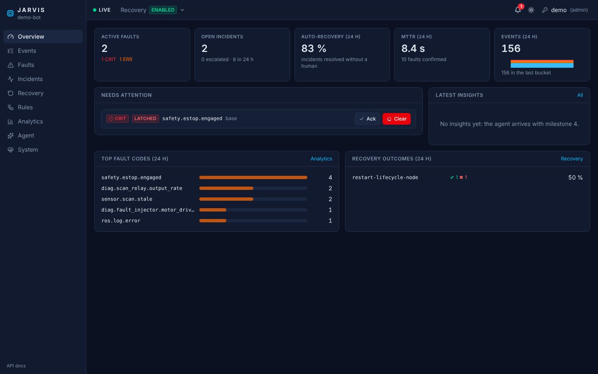
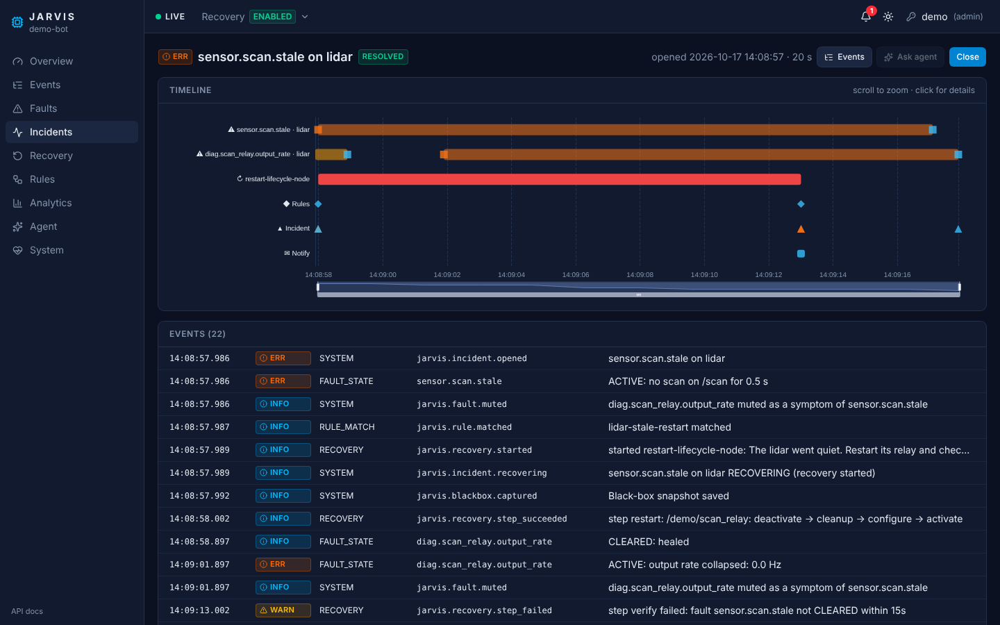

# jarvis_ros2

Jarvis is an event, fault &amp; recovery management system for ROS 2 robots.

- **Record**: every event and fault, with a proper fault lifecycle (debounce, heal, latch, ack).
- **Recover**: automatically, from declarative rules over sequences of events, behind safety gates.
- **Explain**: an agent reads windows of events and produces evidence-backed insights and recovery proposals.
- **Visualize**: a live web dashboard with incident timelines and approvals.

The core is ROS-agnostic; ROS 2 is the communication layer.

## Status

**M1 (record & manage faults) and M2 (rules & automated recovery) are in**: Jarvis records and
manages faults, restarts what hangs on its own, escalates to a human when that doesn't work, and
replays recordings to check rule changes. **M3 (history, analytics and the dashboard) is in**: a web
console over the gateway's API and live stream, with Parquet history behind it. Next is M4, the
agent ([roadmap](docs/design/09-roadmap.md)). The design package starts at
[`docs/design/README.md`](docs/design/README.md).

## Try it in Docker

All you need is Docker. No ROS install, works on Linux, macOS and Windows (WSL):

```bash
git clone https://github.com/guilyx/jarvis_ros2 && cd jarvis_ros2
./demo
```

The first run builds the image (about 10 minutes). Then a guided tour plays in a live view (about a
minute):

1. The lidar relay hangs. Jarvis restarts it, checks that scans flow again, and the recovery succeeds.
2. The lidar itself stops. The restart can't fix that, so the check fails and the operators are
   notified.
3. A motor driver overheats, a node errors in a loop, the e-stop is pressed: Jarvis debounces,
   correlates, latches and records each one.

Ctrl-C leaves the view; Jarvis keeps running. **The dashboard is at http://localhost:8080**: live
events, faults to acknowledge and clear, incident timelines, recoveries to run and approve, the
kill switch, rules and analytics.

| Command | What it does |
|---------|--------------|
| `./demo watch` | Live view of open faults, recoveries and recent events |
| `./demo inject scan-wedge` | Break one thing: `scan-wedge`, `scan-stall`, `scan-slow`, `rosout-error`, `diag-error`, `estop` |
| `./demo clear` | Clear the latched e-stop, as an operator would (Jarvis restarts nothing while it is latched) |
| `./demo jarvis executions` | `ros2 jarvis`: `executions`, `rules`, `recover`, `mode DRY_RUN`, `faults`, ... |
| `./demo api /faults` | The gateway's API: `/faults`, `/incidents`, `/stats`, ... (all of it: http://localhost:8080/docs) |
| `./demo shell` | A shell with ROS 2 ready: `ros2 topic echo /jarvis/faults` |
| `./demo down` | Stop. Recordings stay in `./demo-data/` |

- **Wedge it four times** in ten minutes: the fourth time Jarvis stops restarting it and calls a human.
  Restart it yourself, through the same gates: `./demo jarvis recover restart-lifecycle-node -a
  node=/demo/scan_relay -a component=lidar`.

- **Foxglove**: connect to `ws://localhost:8765` to browse `/jarvis/events`, `/jarvis/faults`, `/scan` and
  `/diagnostics` live. The MCAP recordings in `./demo-data/bags/` open in Foxglove too.
- **Restarts keep open faults**: that's the persistence at work. `./demo clear --all` clears every open
  fault; `rm -rf demo-data` (with `sudo` on Linux: the container writes as root) starts from scratch.
- **No bash** (plain Windows): `docker compose up -d`, then `docker compose exec demo monitor` and
  `docker compose exec demo inject tour`.

## From source

ROS 2 Jazzy, from the root of this repository:

```bash
rosdep install --from-paths core ros --ignore-src -y
colcon build && source install/setup.bash

ros2 launch jarvis_demo demo.launch.py          # Jarvis + a fake lidar, no simulator needed
ros2 run jarvis_demo monitor                    # in another shell: the live view
ros2 run jarvis_demo inject tour                # and in a third: every scenario, narrated
```

With Nav2 and Gazebo installed, `nav2_sim.launch.py` runs the same demo on a simulated TurtleBot 4.

## Use it on your robot

Reporting from your own node is one line, in C++ or Python:

```cpp
jarvis_reporter::Reporter jarvis(node, "lidar");
jarvis.fault("sensor.lidar.stale", Severity::Error, "no scan for 1.2 s", {{"silence_ms", 1200}});
jarvis.clear("sensor.lidar.stale");
```

Or don't report at all: the bridges turn `/diagnostics`, `/rosout` errors, aborted action goals,
lifecycle transitions, silent or slow topics and missing nodes into
faults on their own.

## Recover automatically

A rule watches the event stream and asks for a recovery plan; the orchestrator runs it behind safety
gates (mode, requester, preconditions, rate limits, locks, approvals), verifies the fix and escalates
when it does not work. Rules and plans are YAML directories (`rules:=`, `plans:=` launch arguments):

```yaml
# rules/lidar.yaml (the demo's: ros/jarvis_demo/config/rules/demo.yaml)
schema: jarvis.rules/v1
rules:
  - id: lidar-stale-restart
    when: { event: { kind: FAULT_STATE, code: sensor.scan.stale, attrs.state: ACTIVE } }
    guard: { faults_inactive: [safety.estop.engaged] }
    then:
      - recover:
          plan: restart-lifecycle-node
          args: { node: "{{ event.attrs.node }}", component: lidar, fault: sensor.scan.stale }
    policy: { cooldown: 2s, max_fires: { count: 3, per: 10m } }
  - id: lidar-restarts-exhausted   # the 4th time, the rule above is suppressed: call a human
    when: { event: { kind: SYSTEM, code: jarvis.rule.suppressed, attrs.rule: lidar-stale-restart } }
    then: [ { incident: { escalate: true } }, { notify: { channel: operators, message: "Lidar keeps hanging" } } ]
```

`restart-lifecycle-node` ships in [`jarvis_bringup/config/plans`](ros/jarvis_bringup/config/plans).
Operators use the same gates:

```bash
ros2 jarvis recover restart-lifecycle-node -a node=/scan_relay -a component=lidar --dry-run
ros2 jarvis mode DISABLED            # kill switch (DRY_RUN: decide everything, move nothing)
ros2 jarvis executions --steps       # what runs, what waits for approval, what just finished
```

Before shipping rules, check them and replay a recording through them:

```bash
ros2 jarvis lint --rules rules/ --plans plans/ --catalog faults.yaml
ros2 jarvis backtest ~/.local/share/jarvis/bags/jarvis_<stamp> --rules rules/ --plans plans/
```

The backtest runs the same engine the robot runs and lists every decision that would change.

## History and analytics

Every recording the recorder closes becomes Parquet (`jarvis_lake`, one file per split and day),
and DuckDB queries it in place: no database server on the robot. The views rebuild the story from
the event stream: `events`, `fault_episodes`, `incidents`, `executions`, `rule_matches`,
`operator_actions` (the audit trail).

```bash
ros2 run jarvis_lake jarvis-lake kpis --hours 24     # MTTR, auto-recovery rate, top fault codes,
                                                    # health per component, flapping faults, plans
ros2 run jarvis_lake jarvis-lake sql "SELECT code, count(*) FROM fault_episodes GROUP BY code"
./demo lake kpis                                    # the same in the Docker demo
```

A split the recorder never closed (a crash, a power cut) is recovered up to its last complete
chunk when Jarvis restarts. Retention deletes recordings only after they are converted (7 days or
10 GiB of bags, 180 days or 5 GiB of Parquet, 2 GiB of black-box snapshots by default).

## Dashboard




A web console for operators, served by the gateway (no Node.js on the robot):

- **Overview**: active faults, open incidents, auto-recovery rate, MTTR, event rate, and what needs a
  human (approvals, latched faults, escalations) with the buttons to act.
- **Events**: the live stream, filterable and pausable, with each event's attributes, payload and
  causal chain.
- **Faults** and **Incidents**: acknowledge and clear (with a note, in your name); every incident as
  a timeline of its faults, rule matches, recoveries, operator actions and insights.
- **Recovery**: run a plan (a form from its parameters), approve or reject, cancel, follow its steps
  and gates; the kill switch is in the header.
- **Rules**, **Analytics** (health per component, Pareto of fault codes, when things break, flapping
  faults, plan effectiveness) and **System** (lifecycle states, lake, webhooks, recordings to
  download, the audit trail).

Who you are comes from a token (top right): viewers read, operators act on faults and recoveries,
admins change modes and rules. See [`dashboard/`](dashboard) to develop it.

## API and live stream

The gateway (`jarvis_gateway`) serves Jarvis over HTTP for the dashboard and your tools: events,
faults, incidents with their timeline, recoveries, rules, plans, KPIs and analytics, recordings to
download, and a WebSocket stream that resumes without gaps from any `seq`. Commands (ack, clear,
run a plan, approve, the kill switch, rule state) go to the component that owns them, which records
who asked: every change is in the audit trail. It also delivers the `notify` actions of rules to
webhooks (Slack or JSON) and exposes Prometheus metrics.

```bash
curl localhost:8080/api/v1/faults                                    # open faults
curl -X POST -H "Authorization: Bearer $TOKEN" localhost:8080/api/v1/faults/<id>:ack
curl "localhost:8080/api/v1/events?code=ros.*&min_severity=WARN"     # history: lake + recent
```

It binds `127.0.0.1:8080` by default (LAN-only by design: `gateway_host:=<lan address>` to open
it). Tokens give names and roles (viewer, operator, admin) in
[`gateway.yaml`](gateway/jarvis_gateway/config/gateway.yaml) (`gateway_config:=...`) or
`$JARVIS_GATEWAY_TOKENS`. The API is documented at `/docs` (OpenAPI);
[docs/design/07-dashboard.md](docs/design/07-dashboard.md) lists it. `jarvis-gateway --fake
--scenario` runs it over an in-memory Jarvis, without ROS.

## Packages

| Package | What it does |
|---------|--------------|
| [`core/jarvis_core`](core/jarvis_core) | ROS-free C++ domain: event hub, fault lifecycle, incidents, catalog, rule engine, recovery orchestrator |
| [`ros/jarvis_interfaces`](ros/jarvis_interfaces) | Messages, services and the `ExecuteRecovery` action |
| [`ros/jarvis_ros`](ros/jarvis_ros) | Event hub, fault manager, rule engine and recovery lifecycle components; built-in actuators (lifecycle, std_srvs, parameters, bag snapshot) |
| [`ros/jarvis_cli`](ros/jarvis_cli) | `ros2 jarvis`: faults, rules, recovery, approvals, kill switch, bag export, lint and backtest |
| [`ros/jarvis_nav2`](ros/jarvis_nav2) | Nav2 actuators: lifecycle manager, costmaps, cancel and send goals |
| [`ros/jarvis_reporter`](ros/jarvis_reporter) | C++ and Python client libraries for apps |
| [`ros/jarvis_bridges`](ros/jarvis_bridges) | Diagnostics, rosout, action status and lifecycle bridges; topic and node watchdogs |
| [`ros/jarvis_bringup`](ros/jarvis_bringup) | Launch, parameters, default fault catalog, rules and plans, recorder and black box |
| [`ros/jarvis_demo`](ros/jarvis_demo) | Lidar relay, fault injector, demo launch files |
| [`lake/jarvis_lake`](lake/jarvis_lake) | Recordings as Parquet + DuckDB: history, KPIs, analytics, retention (runs without ROS) |
| [`gateway/jarvis_gateway`](gateway/jarvis_gateway) | REST API, gap-free WebSocket stream, attributed commands, webhooks, Prometheus metrics |
| [`dashboard`](dashboard) | The web console (React + TypeScript), served by the gateway |
| [`schemas`](schemas) | JSON Schema contracts (canonical) |

## Design

| Area | Doc |
|------|-----|
| Requirements | [docs/design/01-requirements.md](docs/design/01-requirements.md) |
| Architecture | [docs/design/02-architecture.md](docs/design/02-architecture.md) |
| Data model & interfaces | [docs/design/03-data-model.md](docs/design/03-data-model.md) |
| Data flow | [docs/design/04-data-flow.md](docs/design/04-data-flow.md) |
| Rules & recovery | [docs/design/05-rules-and-recovery.md](docs/design/05-rules-and-recovery.md) |
| Agent | [docs/design/06-agent.md](docs/design/06-agent.md) |
| Dashboard | [docs/design/07-dashboard.md](docs/design/07-dashboard.md) |
| ROS 2 practices | [docs/design/08-ros2-practices.md](docs/design/08-ros2-practices.md) |
| Roadmap | [docs/design/09-roadmap.md](docs/design/09-roadmap.md) |
| Decisions (ADRs) | [docs/adr/README.md](docs/adr/README.md) |
