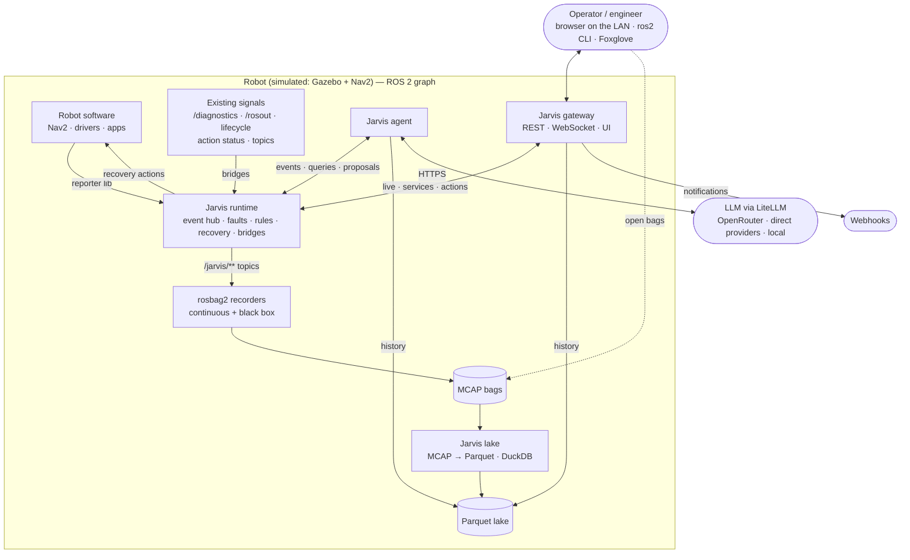
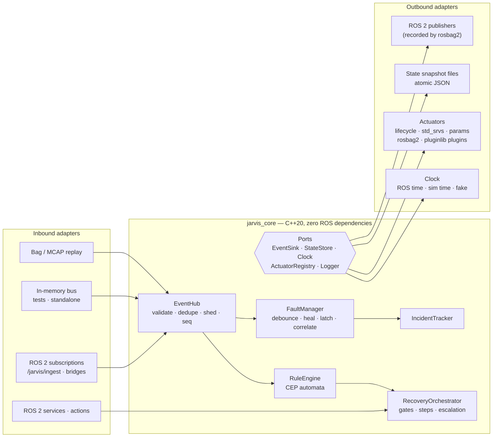
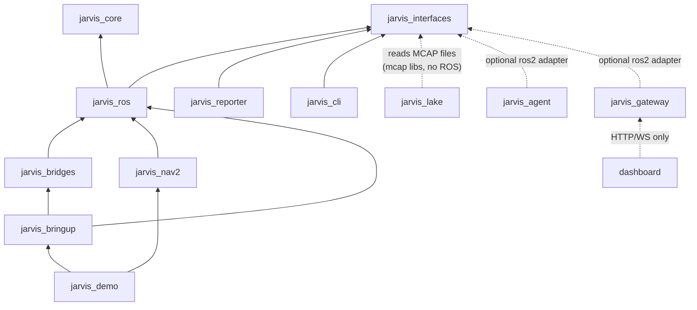
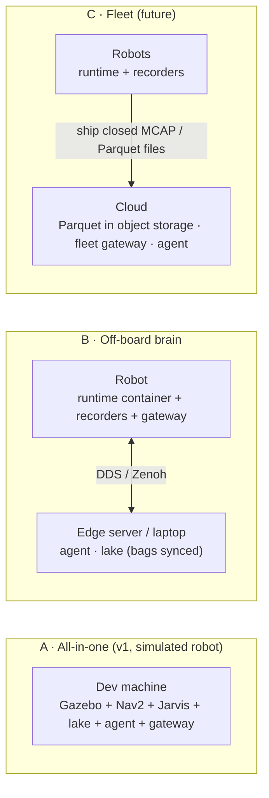

# 02 — Architecture

> **TL;DR**
> - **Hexagonal**: a pure core (no ROS includes) surrounded by ports. ROS 2 is the communication layer.
> - **ROS-native data plane**: everything Jarvis knows is **on the ROS graph** (topics, latched topics,
>   services, actions). **rosbag2 records it** (MCAP), and **Parquet + DuckDB** serve history. No database
>   sits on the hot path.
> - **Functional core, imperative shell**: core services are deterministic state machines
>   (`input → effects`). The same recorded bag always gives the same decisions.
> - **One actuation gate**: every recovery (from a rule, an operator or the agent) goes through the Recovery Orchestrator.

---

## 1. Principles

1. **ROS is the transport, not the domain.** Domain types live in `jarvis_core`. ROS messages are a binding (type adapters, REP-2007).
2. **If it matters, it's on the graph.** Every event, fault transition, rule match, recovery step and insight is published. Anything (rosbag2, Foxglove, `ros2 topic echo`, the dashboard) can observe it.
3. **Right primitive for the job.** Topics for streams, latched topics for current state, services for quick request/response, actions for long-running work. See [03 §9](03-data-model.md#9-communication-patterns).
4. **Record, don't store.** rosbag2 is the system of record (MCAP). History and analytics come from Parquet converted off the hot path. Small state that must survive a restart (open faults, running executions) is written as atomic snapshot files.
5. **One canonical stream.** Only `/jarvis/event_hub` publishes `/jarvis/events`. It validates, de-duplicates, rate-limits and sequences everything.
6. **Deterministic decisions.** Fault manager, rule engine and orchestrator never read wall clocks or do I/O. They receive inputs and return effects.
7. **Least privilege for automation.** The agent has no actuators. Rules can only name plans. Plans can only use registered actions.
8. **Degrade, don't die.** If the LLM is offline, use heuristics. If there's a flood, shed DEBUG/INFO first. If the disk fills, retention evicts the oldest recordings.

## 2. System context



## 3. Hexagonal layering



Outside ROS (standalone mode, tests), `EventSink` is an MCAP or JSONL writer. The core doesn't know the difference.

### Functional core, imperative shell

```cpp
// Pure and deterministic: no I/O, no clocks, no threads.
class RuleEngine {
 public:
  Effects on_event(const Event& e, const StateView& state);
  Effects on_timer(TimerId id, Timestamp now);
};

// Effects are plain data. The adapter (shell) executes them.
using Effect = std::variant<
    EmitEvent,          // → /jarvis/ingest → event hub (sequenced, published, recorded)
    RequestRecovery,    // → orchestrator
    Actuate,            // orchestrator → actuator adapter (async; the result comes back as an input)
    PersistState,       // → atomic snapshot file
    ScheduleTimer, CancelTimer>;
```

This gives:
- **Tests without ROS or threads**: feed events, assert on effects.
- **Backtesting**: replay a recorded bag through the real engine (`jarvis backtest`).
- **Simulation**: a `FakeClock` drives timers; sim time works the same way.

## 4. Packages (monorepo, colcon-friendly)

```text
jarvis_ros2/
├── core/
│   └── jarvis_core/              # C++20: domain, ports, event hub, faults, incidents, CEP, orchestrator. Plain CMake.
├── ros/                          # ROS 2 binding layer (Jazzy)
│   ├── jarvis_interfaces/        # .msg / .srv / .action
│   ├── jarvis_ros/               # type adapters, clock, state files, lifecycle components, actuators, pluginlib bases
│   ├── jarvis_bridges/           # diagnostics · rosout · lifecycle · action status · topic & node watchdogs
│   ├── jarvis_nav2/              # Nav2 actuator plugins (lifecycle manager, costmaps, goals) + bridge presets
│   ├── jarvis_reporter/          # tiny C++ & Python client libraries for apps (client-side debounce)
│   ├── jarvis_cli/               # `ros2 jarvis …` verbs (ros2cli extension)
│   ├── jarvis_bringup/           # launch, params, fault catalog, rules, plans, recorder QoS profiles
│   └── jarvis_demo/              # Nav2 + Gazebo sim, fault injector, demo scenarios
├── lake/jarvis_lake/             # Python: MCAP → Parquet, DuckDB views, retention (no ROS needed to convert)
├── agent/jarvis_agent/           # Python: agent core (agnostic) + adapters (ros2, gateway, replay) + LiteLLM
├── gateway/jarvis_gateway/       # Python: FastAPI REST + WebSocket, notifier, serves the dashboard
├── dashboard/                    # React + TypeScript + Vite
├── schemas/                      # JSON Schema contracts (canonical) + codegen config
├── docs/                         # design, ADRs, runbooks
└── docker/ · .devcontainer/ · .github/
```

### Dependency rules (enforced in CI)



- `core/*` must not include `rclcpp`, `rclpy` or any `*_interfaces` header. CI checks this with grep and a ROS-free build job.
- Python packages import `rclpy` only inside `adapters/ros2.py` (lazy import). Core modules are testable without ROS.
- `jarvis_lake` decodes bags with the `mcap` + `mcap-ros2-support` libraries (schemas are embedded in MCAP), so conversion runs on any machine.

## 5. Runtime components

| Component | Process | Kind | Responsibility |
|-----------|---------|------|----------------|
| `/jarvis/event_hub` | runtime container | lifecycle component (C++) | Single publisher of `/jarvis/events`: validate, de-dupe, rate-limit, shed, sequence. Ring buffer of recent events + `~/query_events`. |
| `/jarvis/fault_manager` | runtime container | lifecycle component (C++) | Fault lifecycle (debounce/heal/latch/correlate), incidents, freeze frames, black-box trigger, `/jarvis/faults` (latched), ack/clear services, `/diagnostics` export, state snapshot |
| `/jarvis/rule_engine` | runtime container | lifecycle component (C++) | Load/validate/hot-reload rules, CEP evaluation, `RULE_MATCH`, recovery requests, policy counters snapshot |
| `/jarvis/recovery` | runtime container | lifecycle component (C++) | `ExecuteRecovery` server, gates, approvals, plan execution, actuators, escalation, `/jarvis/executions` (latched), state snapshot |
| `/jarvis/bridges/*` | runtime container | lifecycle components (C++) | `/diagnostics`, `/rosout`, lifecycle transitions, action goal status, topic/node health → events |
| `/jarvis/recorder` | runtime container | `rosbag2_transport::Recorder` component | Continuous MCAP recording of `/jarvis/**` (+ optional context topics), split every 5 min |
| `/jarvis/blackbox` | own process | rosbag2 recorder, snapshot mode | In-memory ring buffer of high-rate sensor topics, dumped on `~/snapshot` |
| `jarvis_lake` | own process | Python service | Converts closed MCAP splits → Parquet, maintains DuckDB views, enforces retention |
| `/jarvis/agent` | own process | Python node (lifecycle) | Windows, triage, LLM analysis (LiteLLM), insights, proposals, `Analyze` action |
| `/jarvis/gateway` | own process | Python (FastAPI + rclpy adapter) | REST/WS API, notifications, serves the dashboard bundle (LAN-only) |

**Process isolation**: agent, gateway, lake and black-box recorder do network or disk-heavy I/O and run third-party stacks. A crash or a stall there must never affect fault handling or recovery.

### Threading model (runtime container)

- Each core-backed component owns **one MutuallyExclusive callback group** that feeds its core. The core is single-threaded, so it needs no locks.
- Actuator service/action clients run in a **Reentrant** group with `async_send_request` and timeouts. Results come back to the core as inputs.
- State snapshots are written by a small background writer (debounced ≤ 100 ms, write-tmp + fsync + rename). Callbacks never block on disk.
- Container: `component_container_isolated` (one executor thread per component), intra-process communication on between Jarvis components.

## 6. Deployment topologies



- **A** is v1 (one simulated robot, LAN-only dashboard).
- **B** works out of the box: the agent only needs topics, services and the lake.
- **C** gets easier with Parquet: closed files ship to object storage as they are.

## 7. Failure modes & self-protection

| Failure | Behavior |
|---------|----------|
| Event hub crash | Container respawns. `seq` stays monotonic (`boot_count` in the high bits). Producers' reliable QoS buffers (KEEP_LAST 1000) absorb short gaps. Emits `jarvis.event_hub.restarted`. |
| Fault manager crash | Restores open episodes, incidents, latches and acks from its snapshot file, then republishes `/jarvis/faults`. Emits `jarvis.fault_manager.restored`. |
| Orchestrator crash mid-plan | Plans are **not** resumed, because resuming blind is unsafe. The snapshot lists executions that were `RUNNING`. It emits `jarvis.recovery.interrupted` (ERROR) for each and escalates their incidents. |
| Rule engine restart | Partial matches are lost (documented). Cooldowns and `max_fires` counters are restored from the snapshot, so a restart can't cause a recovery storm. Optional warm-up replays the last N minutes from the event hub's ring buffer. |
| Recorder down or lagging | The fault manager raises `jarvis.recorder.down` if `/jarvis/events` has no recorder subscription, or no split closed for 2× the split duration. Live behavior is unaffected. |
| Hard crash / power cut | Open state survives (fsynced snapshots). The last unflushed MCAP chunk (≤ ~1 s) can be lost. Unfinalized MCAP files are recovered by the lake (`mcap recover` / `ros2 bag reindex`). |
| Event flood | Per-(source, code) token bucket. Excess is collapsed into `jarvis.ingest.suppressed` summaries. On overload, DEBUG/INFO are shed first and ≥ ERROR is never dropped. All counted in diagnostics. |
| Disk pressure | Lake retention deletes the oldest MCAP splits that have **already been converted**, then the oldest Parquet partitions. Disk usage is reported in diagnostics. |
| Event loops (rule ↔ rule) | Causal depth is tracked via `causation_id`. Depth > 16 is rejected with `jarvis.loop.detected`. A rule never matches events it caused itself. |
| LLM offline / rate-limited | The agent falls back to the heuristic analyst and marks insights `degraded=true`. |
| Bad config pushed | Hot reload validates first. On error, the old config stays live and errors are returned and emitted as events. |
| Jarvis itself unhealthy | `/diagnostics` (hardware_id `jarvis`) plus a gateway `/health` endpoint. The container is supervised by launch `respawn` (systemd on real robots). |
