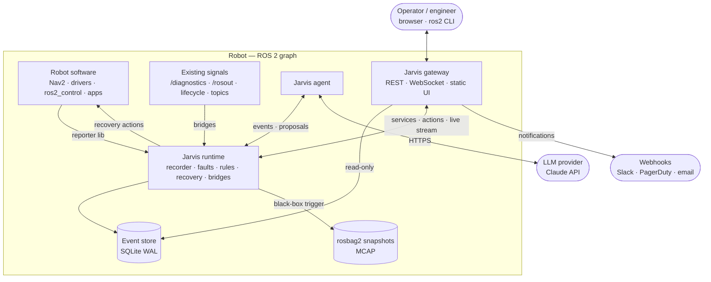
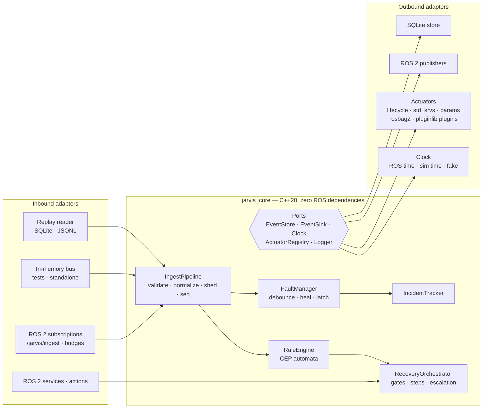
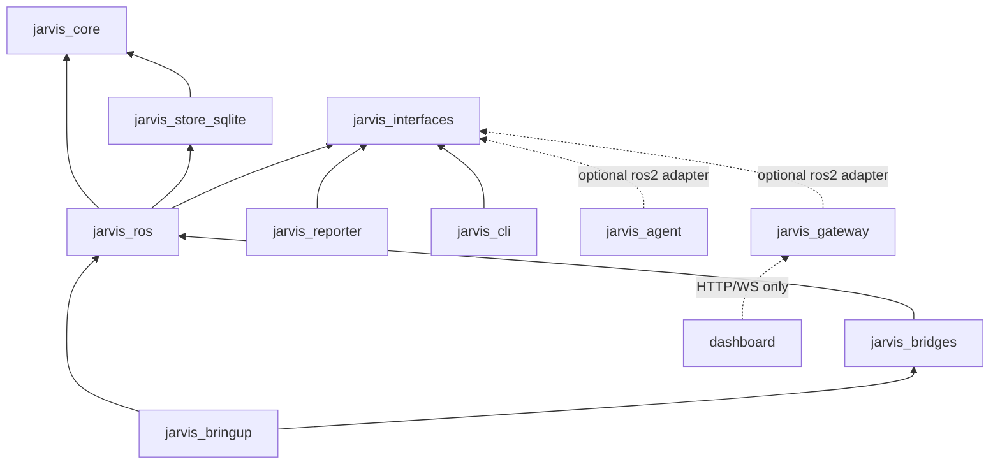
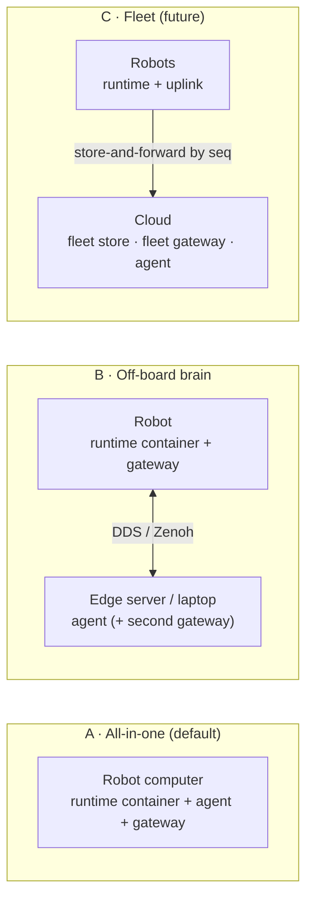

# 02 — Architecture

> **TL;DR**
> - **Hexagonal**: a pure core (no ROS includes) surrounded by ports. ROS 2 is an adapter.
> - **Functional core, imperative shell**: core services are deterministic state machines
>   (`input → effects`). Adapters perform effects. The same event log always gives the same decisions.
> - **Everything is an event**: faults, rule matches, recovery steps, insights and operator
>   actions all go into one append-only log, written by a **single writer** (the recorder).
> - **One actuation gate**: every recovery (from a rule, an operator or the agent) goes through the Recovery Orchestrator.

---

## 1. Principles

1. **ROS is a transport, not the domain.** Domain types live in `jarvis_core`. ROS messages are a binding (type adapters, REP-2007).
2. **Single writer.** Only the recorder writes the store. Everyone else publishes to `/jarvis/ingest` or calls services.
3. **Persist, then publish.** Anything seen on `/jarvis/events` is already in the store, so consumers can backfill by `seq`.
4. **Deterministic decisions.** Rule engine, fault manager and orchestrator never read wall clocks or do I/O. They receive inputs and return effects.
5. **Least privilege for automation.** The agent has no actuators. Rules can only name plans. Plans can only use registered actions.
6. **Degrade, don't die.** If the LLM is offline, use heuristics. If the disk is full, evict low-severity events. If there's a flood, shed DEBUG/INFO first.

## 2. System context



## 3. Hexagonal layering



### Functional core, imperative shell

Each core service has the same shape:

```cpp
// Pure and deterministic: no I/O, no clocks, no threads.
class RuleEngine {
 public:
  Effects on_event(const Event& e, const StateView& state);
  Effects on_timer(TimerId id, Timestamp now);
};

// Effects are plain data. The adapter (shell) executes them.
using Effect = std::variant<
    EmitEvent,          // goes back to the recorder (seq + persist)
    RequestRecovery,    // goes to the orchestrator
    Actuate,            // orchestrator → actuator adapter (async, result comes back as input)
    ScheduleTimer, CancelTimer>;
```

Why this matters:
- **Tests without ROS or threads**: feed events, assert on effects.
- **Backtesting**: replay a recorded log through the real engine (`jarvis backtest`).
- **Simulation**: a `FakeClock` drives timers; sim time works the same way.

## 4. Packages (monorepo, colcon-friendly)

```text
jarvis_ros2/
├── core/                         # ROS-agnostic. Plain CMake / pip. CI enforces "no rclcpp/rclpy".
│   ├── jarvis_core/              # C++20: domain model, ports, ingest, faults, incidents, CEP, orchestrator
│   └── jarvis_store_sqlite/      # C++20: EventStore adapter (SQLite WAL, migrations, retention)
├── ros/                          # ROS 2 binding layer (Jazzy)
│   ├── jarvis_interfaces/        # .msg / .srv / .action
│   ├── jarvis_ros/               # type adapters, clock, lifecycle components, actuators, pluginlib base
│   ├── jarvis_bridges/           # diagnostics · rosout · lifecycle · topic & node watchdogs → events
│   ├── jarvis_reporter/          # tiny C++ & Python client libraries for apps
│   ├── jarvis_cli/               # `ros2 jarvis …` verbs (ros2cli extension)
│   ├── jarvis_bringup/           # launch files, default params, fault catalog, rules, plans
│   └── jarvis_demo/              # demo robot nodes that misbehave on purpose (e2e tests, showcase)
├── agent/jarvis_agent/           # Python 3.12: agent core (agnostic) + adapters (ros2, gateway, replay)
├── gateway/jarvis_gateway/       # Python 3.12: FastAPI REST + WebSocket, notifier, serves dashboard
├── dashboard/                    # React + TypeScript + Vite
├── schemas/                      # JSON Schema contracts (canonical) + codegen config
├── docs/                         # design, ADRs, runbooks
└── docker/ · .devcontainer/ · .github/
```

### Dependency rules (enforced in CI)



- `core/*` must not include `rclcpp`, `rclpy` or any `*_interfaces` header. CI checks this with grep and a ROS-free build job.
- Python packages import `rclpy` only inside `adapters/ros2.py` (lazy import). Core modules are testable without ROS.
- The dashboard only talks to the gateway (OpenAPI-generated client).

## 5. Runtime components

| Component | Process | Kind | Responsibility |
|-----------|---------|------|----------------|
| `/jarvis/recorder` | runtime container | lifecycle component (C++) | Ingest pipeline, **single writer** to the store, FaultManager, IncidentTracker, black-box trigger, query services, `/jarvis/faults` snapshot |
| `/jarvis/rule_engine` | runtime container | lifecycle component (C++) | Load/validate/hot-reload rules, CEP evaluation, emit `RULE_MATCH`, request recoveries |
| `/jarvis/recovery` | runtime container | lifecycle component (C++) | `ExecuteRecovery` action server, gates, approvals, plan execution, actuators, escalation |
| `/jarvis/bridges/*` | runtime container | lifecycle components (C++) | Turn `/diagnostics`, `/rosout`, lifecycle transitions, topic/node health into events |
| `/jarvis/agent` | own process | Python node (lifecycle) | Windows, triage, LLM analysis, insights, proposals, `Analyze` action |
| `/jarvis/gateway` | own process | Python (FastAPI + rclpy adapter) | REST/WS API, auth, notifications (webhooks), serves the dashboard bundle |

**Why the agent and gateway are separate processes**: they do network I/O and run third-party stacks. A crash or a stall there must never affect recording or recovery.

### Threading model (runtime components)

- Each component owns **one MutuallyExclusive callback group** that feeds the core. The core is single-threaded, so it needs no locks.
- Actuator service and action clients run in a **Reentrant** group with `async_send_request` and timeouts. Results come back to the core as inputs.
- The store writer runs on a dedicated thread with a bounded queue and group commit every ≤ 20 ms or every 256 events.
- The container is `component_container_mt` with intra-process communication enabled.

## 6. Deployment topologies



- **A** is v1. **B** works out of the box, because the agent only needs topics and services, or the gateway API.
- **C** is designed for, not built: `robot` id on every event, `seq` cursors for replication, and a CloudEvents mapping for export.

## 7. Failure modes & self-protection

| Failure | Behavior |
|---------|----------|
| Recorder crash | Container respawns. `seq` resumes from the DB. Producers' reliable QoS buffers (KEEP_LAST 1000) absorb short gaps. A `jarvis.recorder.restarted` SYSTEM event is emitted. |
| Orchestrator crash mid-plan | Plans are **not** resumed, because resuming blind is unsafe. On startup it finds executions that are `RUNNING` in the store, emits `jarvis.recovery.interrupted` (ERROR) and escalates their incidents. |
| Event flood | Per-(source, code) token bucket. Excess is collapsed into `jarvis.ingest.suppressed` summaries. If the queue is full, DEBUG/INFO are shed first and ≥ ERROR is never dropped. All of this is counted in diagnostics. |
| Disk pressure | Retention runs early. Lowest-severity, oldest events are evicted first. Fault episodes, incidents and executions are kept longest. |
| Event loops (rule ↔ rule) | The causal depth is tracked via `causation_id`. Events deeper than 16 are rejected with `jarvis.loop.detected`. A rule never matches events it caused itself. |
| LLM offline / rate-limited | The agent falls back to the heuristic analyst and marks insights `degraded=true`. Requests are budgeted and coalesced. |
| Bad config pushed | Hot reload validates first. On error, the old config stays live and errors are returned and emitted as events. |
| Jarvis itself unhealthy | `/diagnostics` (hardware_id `jarvis`) plus a gateway `/health` endpoint. The container is supervised by systemd/launch `respawn`. |
