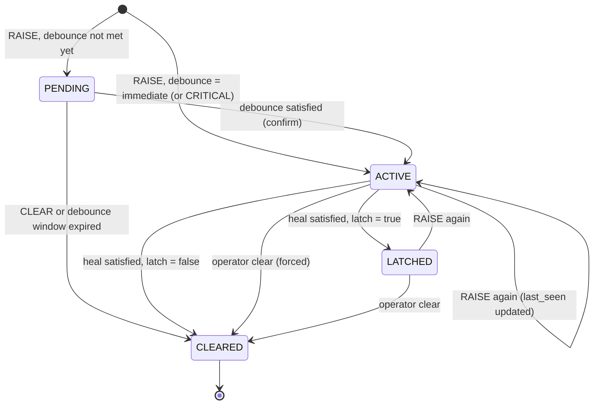
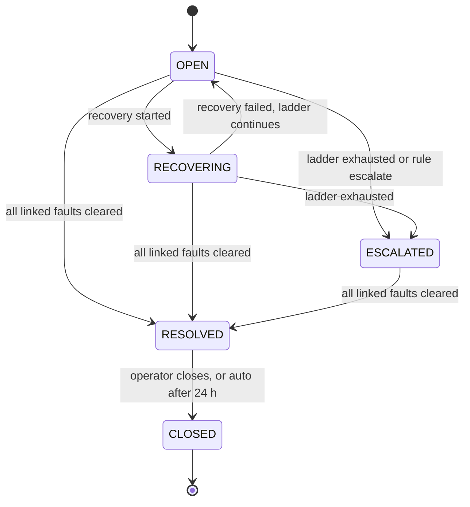
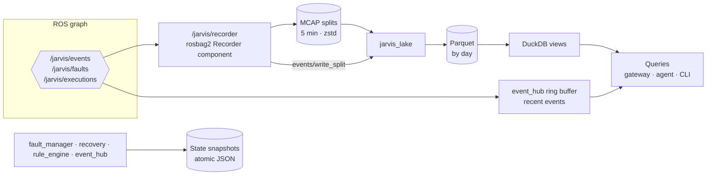
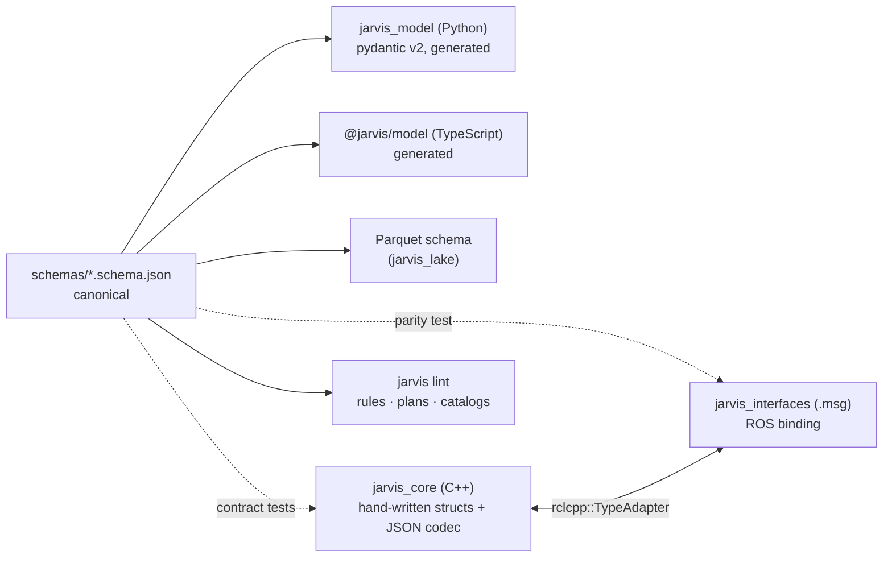

# 03 — Data Model, Interfaces & Persistence

> **TL;DR**
> - One **Event** type for everything, with 10 `kind`s. Faults, incidents and executions are **state**
>   derived from events and published as latched topics.
> - **Not** `diagnostic_msgs` as the event type: diagnostics are status snapshots, not events. Jarvis
>   reads them through a bridge and also publishes back to `/diagnostics` ([§10](#10-why-not-diagnostic_msgs-as-the-event-type)).
> - **Persistence is ROS-native**: rosbag2 records `/jarvis/**` to MCAP, `jarvis_lake` converts closed
>   splits to Parquet, and DuckDB queries them. The event hub keeps a recent-events ring buffer. Small state
>   (open faults, running executions) is saved as atomic snapshot files.
> - **JSON Schema** (`schemas/`) is the canonical contract. ROS `.msg` files are a binding.

---

## 1. Event

| Field | Type | Required | Notes |
|-------|------|----------|-------|
| `id` | string (UUIDv7) | yes | Generated by the producer (the hub fills it if empty). Time-ordered; used for idempotent de-duplication. |
| `seq` | uint64 | — | Assigned by the event hub: `(boot_count << 48) \| counter`, so it stays monotonic across restarts. `0` on `/jarvis/ingest`. |
| `stamp` | time (ns) | yes | When it happened (producer clock; sim time in simulation). |
| `recv_stamp` | time (ns) | — | When the hub ingested it. Default rule time base. |
| `source.robot` | string | yes | Robot / system id. Defaults to the hub's `robot_id` param. |
| `source.node` | string | yes | Emitting node FQN (or any producer id outside ROS). |
| `source.component` | string | no | Logical thing the event is *about* (`lidar_front`, `controller_server`). Defaults to `node`. |
| `source.host` | string | no | Hostname. |
| `kind` | enum | yes | See §2. |
| `code` | string | yes | Dotted, lowercase: `^[a-z0-9_]+(\.[a-z0-9_]+)*$`, ≤ 128 chars. |
| `severity` | enum | yes | See §3. |
| `message` | string | no | Human readable, ≤ 1 KiB. |
| `attrs` | map<string, string\|int\|double\|bool> | no | Flat, typed, filterable. ≤ 32 keys. |
| `tags` | string[] | no | ≤ 16. |
| `payload` | JSON string | no | Structured document (insight, rule-match detail, …), ≤ 64 KiB. |
| `payload_schema` | string | no | e.g. `jarvis.insight/v1`. |
| `correlation_id` | string | no | Incident id this event belongs to. |
| `causation_id` | string | no | `id` of the event that caused this one. |

```json
{
  "id": "01928f6e-7c1a-7b3e-9a51-3f0c2d4e5a61",
  "seq": 281474976711698,
  "stamp": "2026-10-13T09:14:03.120Z",
  "recv_stamp": "2026-10-13T09:14:03.124Z",
  "source": { "robot": "tb4-sim", "node": "/jarvis/bridges/topic_watchdog", "component": "lidar", "host": "devbox" },
  "kind": "FAULT_RAISE",
  "code": "ros.topic.stale",
  "severity": "ERROR",
  "message": "/scan silent for 1.6 s (expected 10 Hz)",
  "attrs": { "topic": "/scan", "expected_hz": 10.0, "silence_s": 1.6, "node": "/demo/scan_relay" },
  "tags": ["perception"]
}
```

## 2. Kinds

| Kind | Who emits it | Meaning |
|------|--------------|---------|
| `LOG` | producers, rosout bridge | Something noteworthy happened. Not a fault signal by itself. |
| `STATE` | producers, lifecycle bridge | Latest-value-wins signal: `robot.mode = AUTONOMOUS`, `nav.goal.status = ACTIVE`. Used by guards. |
| `FAULT_RAISE` | producers, bridges | A fault condition was detected (the FAILED report in AUTOSAR DEM terms). |
| `FAULT_CLEAR` | producers, bridges | The condition is gone (the PASSED report). |
| `FAULT_STATE` | fault manager | Episode transition (`attrs.state`, `attrs.prev_state`, `attrs.fault_id`). |
| `RULE_MATCH` | rule engine | A rule fired. `payload` holds matched event ids and bindings. |
| `RECOVERY` | orchestrator | Execution lifecycle (`attrs.phase`, `attrs.plan`, `attrs.execution_id`, `attrs.step`). |
| `INSIGHT` | agent | Analysis result (`payload` = Insight). |
| `OPERATOR` | gateway / CLI | Human action (ack, clear, approve, trigger, mode change). `attrs.user`. |
| `SYSTEM` | Jarvis internals | Startup, reload, suppression, loop detection, notifications (`jarvis.notify`), agent requests (`jarvis.agent.request`). |

> **Notifications and agent requests are events too.** The core never does network I/O.
> It emits `jarvis.notify`, and the gateway delivers webhooks. It emits `jarvis.agent.request`, and the agent picks it up.

## 3. Severity

| Severity | Value | ROS log | `diagnostic_msgs` | Typical use |
|----------|-------|---------|-------------------|-------------|
| `DEBUG` | 10 | DEBUG | — | Developer detail |
| `INFO` | 20 | INFO | OK | Normal operation, state changes |
| `WARN` | 30 | WARN | WARN | Degraded, still functional |
| `ERROR` | 40 | ERROR | ERROR | Function lost, needs recovery |
| `CRITICAL` | 50 | FATAL | STALE *(configurable)* | Mission/safety-relevant, needs a human |

## 4. Code naming convention

`<domain>.<subsystem>.<condition>` — e.g. `power.battery.low`, `nav.localization.lost`, `ros.action.navigate_to_pose.aborted`.

| Prefix | Reserved for |
|--------|--------------|
| `jarvis.*` | Jarvis internals (`jarvis.ingest.suppressed`, `jarvis.recorder.down`, `jarvis.recovery.interrupted`) |
| `ros.*` | Generic bridges: topic watchdog (`ros.topic.stale`, `ros.topic.slow`), node watchdog (`ros.node.missing`), lifecycle bridge (`ros.lifecycle.inactive`, `ros.lifecycle.failed`, STATE `ros.lifecycle.<node>.state`), rosout bridge (`ros.log.error`) |
| `ros.action.*` | Action status bridge (`ros.action.navigate_to_pose.aborted`) |
| `diag.*` | Diagnostics bridge default mapping (`diag.<normalized status name>`) |

## 5. Fault model

A fault is keyed by **`(robot, code, component)`**. Each lifecycle is an **episode** with its own `fault_id`.



| Field | Notes |
|-------|-------|
| `fault_id` | UUIDv7 per episode |
| `code`, `source` | Identity. `reporting_sources[]` keeps every node that reported it. |
| `state` | `PENDING` · `ACTIVE` · `LATCHED` · `CLEARED` |
| `severity` | From the catalog; escalates if a higher severity is reported |
| `occurrences`, `first_seen`, `last_seen`, `confirmed_at`, `cleared_at` | Occurrences count **edges** (raised after a clear), not repeated reports |
| `acknowledged`, `acknowledged_by`, `acknowledged_at` | Operator ack (separate from clear) |
| `muted_by` | Root-cause fault id when this fault is a correlated symptom |
| `freeze_frame` | Report `attrs` + configured topic samples + `STATE` values at confirmation |
| `incident_id`, `snapshot_ref` | Links |

### Debounce & heal modes

| Mode | Config | Use when |
|------|--------|----------|
| `immediate` | `debounce: immediate` | Default; edge-triggered reporters |
| `count` | `debounce: { count: 3, within: 10s }` | Bursty reports |
| `persist` | `debounce: { persist: 1s }` | Condition must hold for a while |
| `counter` *(AUTOSAR DEM, as in ros2_medkit)* | `debounce: { counter: { confirm_at: -3, heal_at: 3 } }` | Periodic reporters (diagnostics at 1 Hz): RAISE −1, CLEAR +1. Robust to flapping. |
| Heal | `heal: { on_clear: true, after: 30s }` | Explicit clear and/or auto-heal after silence |

`CRITICAL` reports always confirm immediately.

### Fault catalog (`config/faults.yaml`)

```yaml
schema: jarvis.faults/v1
defaults:
  severity: ERROR
  debounce: immediate
  heal: { on_clear: true, after: 30s }
  latch: false
faults:
  - code: ros.topic.stale
    description: A watched topic stopped publishing.
    debounce: { persist: 1s }
    capture:
      freeze_frame: [/odom, /cmd_vel]      # sample these topics at confirmation
      blackbox: true                       # dump the black-box ring buffer (rosbag2 snapshot)
    runbook: runbooks/ros.topic.stale.md
  - code: ros.action.navigate_to_pose.aborted
    severity: ERROR
    heal: { on_clear: true }               # next SUCCEEDED goal clears it
  - code: drive.motor.overcurrent
    severity: WARN
    debounce: { counter: { confirm_at: -3, heal_at: 3 } }
  - code: safety.estop.engaged
    severity: CRITICAL
    latch: true                            # needs operator clear after release
    incident: always
correlation:                               # borrowed from ros2_medkit
  - id: estop-cascade
    root: [safety.estop.engaged]
    symptoms: ["drive.*", "nav.controller.*", "ros.action.*"]
    window: 1s
    mute_symptoms: true                    # still recorded, hidden from the active list
    clear_with_root: true
```

Unknown codes are accepted with the defaults and flagged `attrs.uncataloged = true`, so nothing is lost. A lint warning lists them.

## 6. Incident model

An incident opens when a fault becomes `ACTIVE` with severity ≥ `incident.min_severity` (default `ERROR`), or when a rule action opens one. A new fault on the **same component**, or a correlated symptom, joins the open incident within `incident.merge_window` (default 120 s).



## 7. Recovery execution model

| Field | Notes |
|-------|-------|
| `execution_id` | UUIDv7 |
| `plan_id`, `plan_rev`, `args` | What runs (`plan_rev` = content hash) |
| `requester` | `{type: RULE\|OPERATOR\|AGENT\|PLAN, id}` |
| `state` | `PENDING_APPROVAL` · `QUEUED` · `RUNNING` · `SUCCEEDED` · `FAILED` · `ABORTED` · `REJECTED` · `EXPIRED` |
| `gates` | Per-gate result (audit trail) |
| `steps[]` | `{id, action, state, attempts, started, finished, message}` |
| `approved_by`, `correlation_id`, `causation_id` | Links |

## 8. Insight (agent output)

```json
{
  "insight_id": "01928f71-…",
  "trigger": { "type": "INCIDENT_OPENED", "ref": "inc-01928f6e-…" },
  "window": { "from": "…", "to": "…", "event_count": 214, "correlation_id": "inc-…" },
  "title": "Lidar relay stalls after CPU spikes in Gazebo",
  "summary": "/scan went stale 3 times in 10 min; each stall follows a real-time-factor drop below 0.4 …",
  "assessment": "ERROR",
  "hypotheses": [
    { "cause": "Simulator overload starves the relay", "confidence": 0.62,
      "evidence": ["01928f6e-…", "01928f6f-…"], "counter_evidence": [] }
  ],
  "recommendations": [
    { "kind": "RECOVER", "text": "Restart the scan relay", "plan_id": "restart-lifecycle-node",
      "args": { "node": "/demo/scan_relay" } },
    { "kind": "INVESTIGATE", "text": "Check Gazebo real-time factor" }
  ],
  "proposals": ["exec-01928f72-…"],
  "degraded": false,
  "model": { "provider": "litellm", "name": "<configured model>", "input_tokens": 18234, "output_tokens": 1650, "cost_usd": 0.07 }
}
```

The harness rejects evidence ids that were not present in the window or in tool results.

## 9. Communication patterns

| Need | ROS primitive | QoS / notes | Jarvis uses it for |
|------|---------------|-------------|--------------------|
| Stream of facts, many producers/consumers, fire-and-forget | **Topic** | RELIABLE, VOLATILE, KEEP_LAST N | `/jarvis/ingest`, `/jarvis/events` |
| Current state that late joiners must see | **Latched topic** | RELIABLE, TRANSIENT_LOCAL, KEEP_LAST 1, publish on change | `/jarvis/faults`, `/jarvis/executions` |
| Quick query or command that completes immediately | **Service** | Async clients with timeouts; never called from inside a callback synchronously | query events, get/ack/clear faults, reload, set mode, approve |
| Long-running work that needs feedback and cancel | **Action** | Goal → feedback → result; cancellable | `ExecuteRecovery`, `Analyze` |
| Tunables | **Parameters** | Typed and validated (`generate_parameter_library`) | Rates, buffer sizes, thresholds |
| Structured config (rules, plans, catalog) | **YAML files** + reload service | JSON Schema validated | Too nested for parameters |
| Health of Jarvis itself | **`/diagnostics`** | Standard `diagnostic_updater` | Self-monitoring |

**Why fault reporting uses a topic, not a service** (ros2_medkit uses a `ReportFault` service): reports must never block a control loop or depend on the fault manager being up. The reporter library does client-side debounce and rate-limiting, then publishes RELIABLE KEEP_LAST 1000. Delivery is confirmed indirectly, because the report shows up on `/jarvis/events`.

## 10. Why not `diagnostic_msgs` as the event type?

Short answer: **diagnostics in, diagnostics out, events in the middle.**

| `DiagnosticStatus` has… | Jarvis needs… |
|-------------------------|---------------|
| A periodic **status snapshot** (republished at ~1 Hz while it holds) | An **edge** ("this happened at t"), recorded once |
| No id, no per-status timestamp (only the array header) | `id`, `stamp`, `seq` for ordering, de-dupe and replay |
| String-only `values` | Typed attrs for `gt/lt` rules |
| No lifecycle (raise/confirm/heal/latch/ack) | A fault state machine |
| No causality | `correlation_id`, `causation_id` for incident timelines |
| No notion of rule matches, recoveries, insights, operator actions | One log for all of them |

The ros2_medkit authors reached the same conclusion ("why we did not extend `/diagnostics`").

How Jarvis stays compatible:
- **In**: the diagnostics bridge turns level **changes** into `FAULT_RAISE`/`FAULT_CLEAR` (OK→CLEAR, WARN/ERROR→RAISE, STALE→RAISE as CRITICAL). It maps `name→code`, `hardware_id→component` and `values→attrs`. Steady states are not re-recorded. The `counter` debounce mode handles flapping 1 Hz sources.
- **Out**: the fault manager publishes active faults on `/diagnostics` (hardware_id `jarvis`), so `rqt_robot_monitor`, `diagnostic_aggregator` and Foxglove's diagnostics panel show Jarvis faults with no extra work. The bridge ignores `hardware_id == jarvis`, so there's no loop.

## 11. ROS 2 interfaces (`jarvis_interfaces`) — draft

### Messages

```text
# msg/Attribute.msg
uint8 TYPE_STRING=0
uint8 TYPE_INT=1
uint8 TYPE_DOUBLE=2
uint8 TYPE_BOOL=3
string key
uint8 type
string string_value
int64 int_value
float64 double_value
bool bool_value
```

```text
# msg/Source.msg
string robot
string node
string component
string host
```

```text
# msg/Event.msg
uint8 KIND_UNSPECIFIED=0
uint8 KIND_LOG=1
uint8 KIND_STATE=2
uint8 KIND_FAULT_RAISE=3
uint8 KIND_FAULT_CLEAR=4
uint8 KIND_FAULT_STATE=5
uint8 KIND_RULE_MATCH=6
uint8 KIND_RECOVERY=7
uint8 KIND_INSIGHT=8
uint8 KIND_OPERATOR=9
uint8 KIND_SYSTEM=10

uint8 SEVERITY_DEBUG=10
uint8 SEVERITY_INFO=20
uint8 SEVERITY_WARN=30
uint8 SEVERITY_ERROR=40
uint8 SEVERITY_CRITICAL=50

string id
uint64 seq
builtin_interfaces/Time stamp
builtin_interfaces/Time recv_stamp
Source source
uint8 kind
string code
uint8 severity
string message
Attribute[] attrs
string[] tags
string payload
string payload_schema
string correlation_id
string causation_id
```

```text
# msg/Fault.msg
uint8 STATE_PENDING=1
uint8 STATE_ACTIVE=2
uint8 STATE_LATCHED=3
uint8 STATE_CLEARED=4

string fault_id
string code
Source source
string[] reporting_sources
uint8 state
uint8 severity
uint32 occurrences
builtin_interfaces/Time first_seen
builtin_interfaces/Time last_seen
builtin_interfaces/Time confirmed_at
bool acknowledged
string acknowledged_by
string muted_by
string incident_id
string snapshot_ref
string description
Attribute[] freeze_frame
```

`FaultArray.msg` (`stamp`, `Fault[] faults` — non-cleared only), and `Execution.msg` / `ExecutionArray.msg` (running and pending executions with step progress).

### Services

| Service | Type | Request → Response |
|---------|------|--------------------|
| `/jarvis/event_hub/query_events` | `QueryEvents` | `after_seq, since, until, kinds[], codes[] (globs), min_severity, component, correlation_id, limit` → `events[], next_seq, complete` (`complete=false` if the ring buffer no longer covers the range; use the lake) |
| `/jarvis/fault_manager/get_faults` | `GetFaults` | `include_cleared, include_muted, codes[], component, limit` → `faults[]` |
| `/jarvis/fault_manager/acknowledge_fault` | `AcknowledgeFault` | `fault_id, operator_name, note` → `success, message` |
| `/jarvis/fault_manager/clear_fault` | `ClearFault` | `fault_id, operator_name, reason, skip_symptoms` → `success, message, cleared_symptoms[]` |
| `/jarvis/rule_engine/reload` · `/jarvis/recovery/reload` | `ReloadConfig` | `validate_only` → `success, revision, errors[]` |
| `/jarvis/rule_engine/set_rule_state` | `SetRuleState` | `rule_id, enabled, dry_run` → `success, message` |
| `/jarvis/recovery/set_mode` | `SetRecoveryMode` | `mode (ENABLED/DRY_RUN/DISABLED), operator_name, reason` → `success, previous_mode` |
| `/jarvis/recovery/decide` | `DecideApproval` | `execution_id, approve, operator_name, note` → `success, message` |

### Actions

```text
# action/ExecuteRecovery.action
uint8 REQUESTER_OPERATOR=1
uint8 REQUESTER_RULE=2
uint8 REQUESTER_AGENT=3
uint8 REQUESTER_PLAN=4
string plan_id
Attribute[] args
uint8 requester_type
string requester_id
string correlation_id
string causation_id
string rationale
bool dry_run
---
uint8 OUTCOME_SUCCEEDED=1
uint8 OUTCOME_FAILED=2
uint8 OUTCOME_ABORTED=3
uint8 OUTCOME_REJECTED=4
uint8 OUTCOME_EXPIRED=5
string execution_id
uint8 outcome
string reason
string failed_step
---
uint8 STATE_PENDING_APPROVAL=1
uint8 STATE_QUEUED=2
uint8 STATE_RUNNING=3
string execution_id
uint8 state
string step_id
uint16 step_index
uint16 step_count
string message
```

```text
# action/Analyze.action   (served by the agent)
string question          # empty = "explain this window"
string correlation_id    # analyze an incident…
builtin_interfaces/Time since
builtin_interfaces/Time until  # …or a time range
string effort            # low | medium | high
---
string insight_id
string insight_json
---
string phase             # windowing | triage | investigating | writing
uint16 tool_calls
string message
```

### Topics & QoS

| Topic | Type | Reliability | Durability | History | Recorded |
|-------|------|-------------|------------|---------|----------|
| `/jarvis/ingest` | `Event` | RELIABLE | VOLATILE | KEEP_LAST 1000 | no (raw input) |
| `/jarvis/events` | `Event` | RELIABLE | VOLATILE | KEEP_LAST 1000 | **yes** |
| `/jarvis/faults` | `FaultArray` | RELIABLE | TRANSIENT_LOCAL | KEEP_LAST 1 | **yes** |
| `/jarvis/executions` | `ExecutionArray` | RELIABLE | TRANSIENT_LOCAL | KEEP_LAST 1 | **yes** |
| `/diagnostics` | `diagnostic_msgs/DiagnosticArray` | default | default | default | optional |

All names are relative (`events`, `~/query_events`) in the `jarvis` namespace. Multi-robot setups push a robot namespace.

> Field names avoid C++ and Python keywords (`operator_name`, `since`/`until`), because rosidl generates code in both languages.

## 12. Persistence (ROS-native, no database on the hot path)



| Layer | What | Where | Retention (default) |
|-------|------|-------|---------------------|
| **Live** | `/jarvis/events` stream; latched `/jarvis/faults`, `/jarvis/executions` | ROS graph | — |
| **Recent** | Ring buffer in the event hub, served by `~/query_events` | Memory, ≤ 128 MiB, severity-aware eviction | ~30 min at normal rates |
| **Recorded** | Continuous MCAP of `/jarvis/**` (+ optional low-rate context topics) | `$JARVIS_DATA/bags/` | 7 days / 10 GiB; a split is deleted only **after** conversion |
| **History** | Parquet (`events/date=YYYY-MM-DD/<split>.parquet`) + DuckDB views (`events`, `fault_transitions`, `fault_episodes`, `incidents`, `executions`, `rule_matches`, `operator_actions`); KPIs and analytics in `jarvis_lake.analytics` | `$JARVIS_DATA/lake/` | 180 days / 5 GiB |
| **State** | Open fault episodes, incidents, acks, latches; running executions; rule cooldowns/counters; hub `boot_count` | `$JARVIS_DATA/state/*.json` (write tmp → fsync → rename) | Current only |
| **Black box** | High-rate sensor topics in a rosbag2 **snapshot-mode** ring buffer, dumped on fault | `$JARVIS_DATA/blackbox/` | 2 GiB budget |

All of it keeps 1 GiB of the disk free (`lake_min_free_gib`): below that, the lake deletes converted splits, then black-box snapshots, then old Parquet days, whatever their age, and raises `jarvis.storage.low` if that is not enough.

Notes:
- **Why this split**: bags are the ROS-standard record. They open in Foxglove/PlotJuggler next to sensor data, and replay feeds backtesting directly. Parquet + DuckDB gives fast ad-hoc queries and analytics with no server, and it ships to the cloud as plain files later.
- **Freshness**: the lake converts each split when rosbag2 announces it closed (`events/write_split`), so history lags by ≤ 5 min. The ring buffer covers that gap. The gateway merges both by `seq`.
- **Durability trade-off (vs. a database)**: the recorder is a subscriber in the same process, so events are recorded unless that process dies. The recorder writes MCAP records as they come, unchunked (`config/mcap_writer.yaml`), so a hard crash loses only its file buffer (≤ ~1 s); unfinalized files are recovered by the lake. **Critical state never depends on bags**: open faults and running executions live in fsynced snapshots.
- **Recorder QoS**: rosbag2 QoS overrides match the publishers (RELIABLE; TRANSIENT_LOCAL for the latched topics), so late starts still capture the current fault state.

```sql
-- DuckDB, as jarvis_lake builds it (lake/jarvis_lake/jarvis_lake/views.py)
CREATE VIEW events AS                -- the lake, plus the hub's recent events above its newest seq
  SELECT ... FROM read_parquet('lake/events/date=*/*.parquet', union_by_name = true);

CREATE VIEW fault_transitions AS
  SELECT ts, code, component, json_extract_string(attrs, '$.fault_id') AS fault_id,
         json_extract_string(attrs, '$.state') AS state, severity, correlation_id AS incident_id
  FROM events WHERE kind = 'FAULT_STATE';
```

- **Rows**: one per event, the columns of `event.schema.json` flattened (`robot`, `node`, `component`, `host`), `attrs` as JSON text, `ts` = `recv_stamp` else `stamp`, `split` = the MCAP split it came from. A split converts to one file per UTC day, named after the split, so converting it again replaces the same files.
- **Which splits**: a closed split (its MCAP footer is there) as soon as the recorder announces it (`events/write_split`) or the next scan finds it; a split that was never closed only once the recorder has moved on (a newer split or bag), read as a stream up to its last complete record (or chunk). A split that cannot be read is recorded as failed and does not hold back the others. `lake/ledger.json` lists what was converted; `lake/status.json` is what the gateway shows.

## 13. Contracts & code generation



- Schemas cover `Event`, `Fault`, `Incident`, `Execution`, `Insight`, `Rule`, `Plan` and `FaultCatalog`.
- **CloudEvents mapping** for export: `id→id`, `source→/robots/{robot}{node}`, `type→jarvis.{kind}`, `subject→{code}`, `time→stamp`, `data→{attrs, payload}`.
