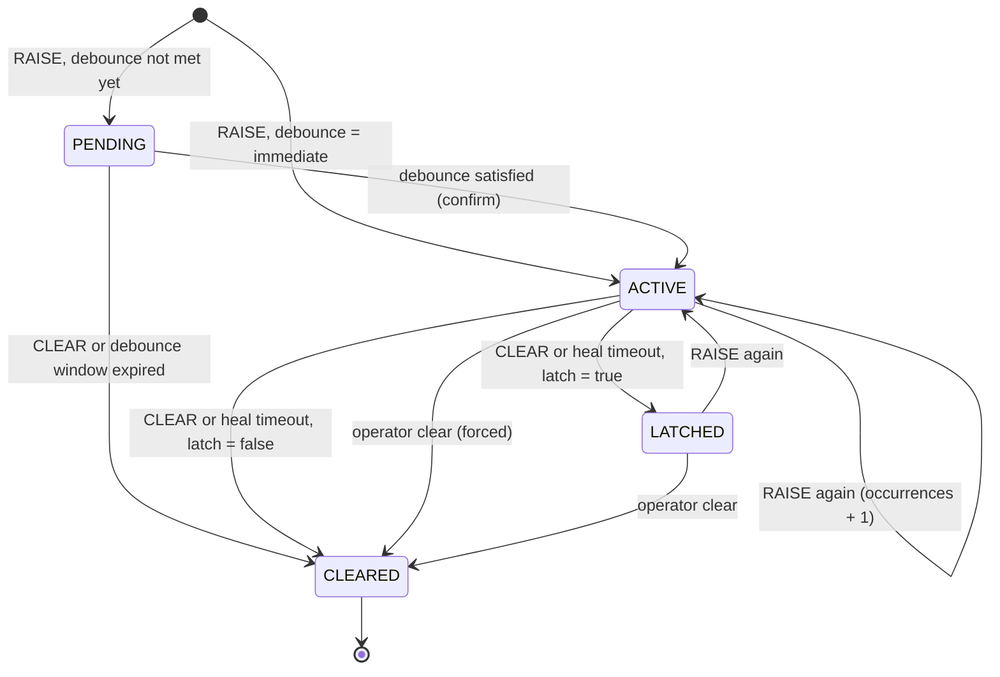
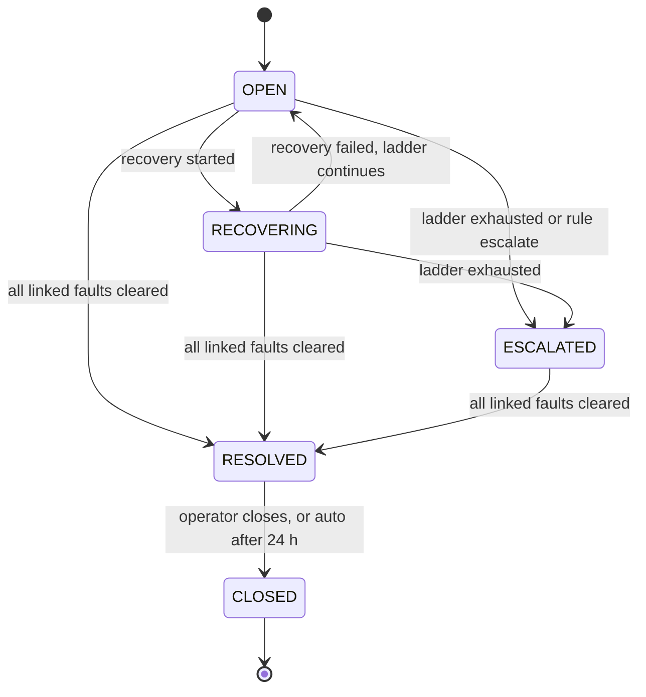
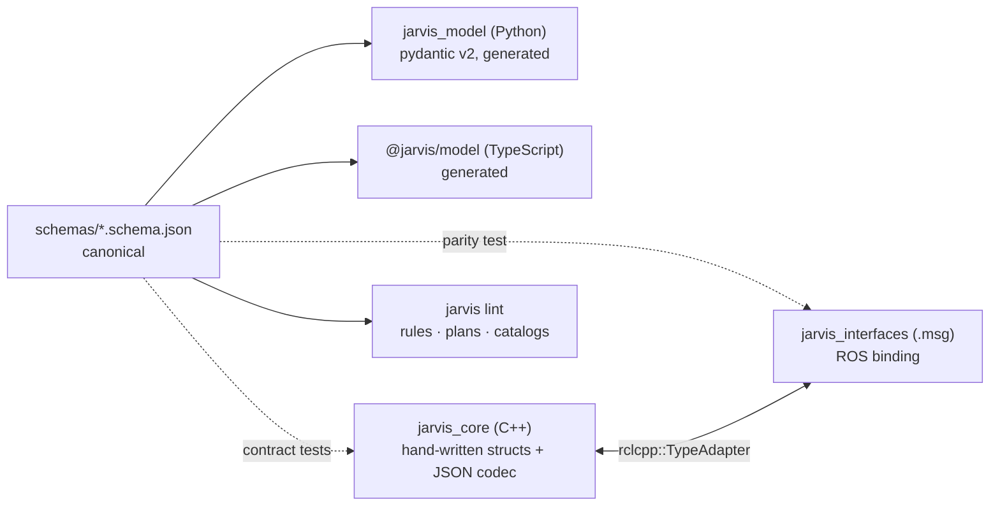

# 03 — Data Model & Interfaces

> **TL;DR**
> - One **Event** type for everything, with 10 `kind`s. Faults, incidents and executions are
>   **projections** (derived tables) rebuilt from events.
> - **JSON Schema** (`schemas/`) is the canonical contract. C++ structs, Python (pydantic) and
>   TypeScript types are generated or contract-tested against it. ROS `.msg` files are a binding.
> - Topics: `/jarvis/ingest` (in), `/jarvis/events` (canonical, persisted), `/jarvis/faults` (latched snapshot).

---

## 1. Event

| Field | Type | Required | Notes |
|-------|------|----------|-------|
| `id` | string (UUIDv7) | yes | Generated by the producer (recorder fills it if empty). Time-ordered and used for idempotent de-duplication. |
| `seq` | uint64 | — | Assigned by the recorder. Monotonic per store. `0` on `/jarvis/ingest`. |
| `stamp` | time (ns) | yes | When it happened (producer clock). |
| `recv_stamp` | time (ns) | — | When the recorder ingested it (recorder node clock). Used as the default rule time base. |
| `source.robot` | string | yes | Robot / system id. Defaults to the recorder's `robot_id` param. |
| `source.node` | string | yes | Emitting node FQN (or any producer id outside ROS). |
| `source.component` | string | no | Logical thing the event is *about* (`lidar_front`). Defaults to `node`. |
| `source.host` | string | no | Hostname. |
| `kind` | enum | yes | See §2. |
| `code` | string | yes | Dotted, lowercase: `^[a-z0-9_]+(\.[a-z0-9_]+)*$`, ≤ 128 chars. |
| `severity` | enum | yes | See §3. |
| `message` | string | no | Human readable, ≤ 1 KiB. |
| `attrs` | map<string, string\|int\|double\|bool> | no | Flat, filterable. ≤ 32 keys, keys ≤ 64 chars. |
| `tags` | string[] | no | ≤ 16. |
| `payload` | JSON string | no | Structured document (insight, rule match detail, …), ≤ 64 KiB. |
| `payload_schema` | string | no | e.g. `jarvis.insight/v1`. |
| `correlation_id` | string | no | Incident id this event belongs to. |
| `causation_id` | string | no | `id` of the event that caused this one (causal chain). |

```json
{
  "id": "01928f6e-7c1a-7b3e-9a51-3f0c2d4e5a61",
  "seq": 1042,
  "stamp": "2026-10-13T09:14:03.120Z",
  "recv_stamp": "2026-10-13T09:14:03.124Z",
  "source": { "robot": "amr-07", "node": "/jarvis/bridges/topic_watchdog", "component": "lidar_front", "host": "orin-01" },
  "kind": "FAULT_RAISE",
  "code": "ros.topic.stale",
  "severity": "ERROR",
  "message": "/sensors/lidar_front/scan silent for 1.6 s (expected 10 Hz)",
  "attrs": { "topic": "/sensors/lidar_front/scan", "expected_hz": 10.0, "silence_s": 1.6, "node": "/sensors/lidar_front_driver" },
  "tags": ["perception"],
  "correlation_id": "",
  "causation_id": ""
}
```

## 2. Kinds

| Kind | Who emits it | Meaning |
|------|--------------|---------|
| `LOG` | producers, rosout bridge | Something noteworthy happened. Not a fault signal by itself. |
| `STATE` | producers, lifecycle bridge | Latest-value-wins signal: `robot.mode = AUTONOMOUS`, `mission.status = RUNNING`. Used by guards. |
| `FAULT_RAISE` | producers, bridges | A fault condition occurred (input to the Fault Manager). |
| `FAULT_CLEAR` | producers, bridges | A fault condition went away. |
| `FAULT_STATE` | Fault Manager | Fault episode transition (`attrs.state`, `attrs.prev_state`, `attrs.fault_id`). |
| `RULE_MATCH` | Rule Engine | A rule fired. `payload` holds the matched event ids and bindings. |
| `RECOVERY` | Orchestrator | Execution lifecycle (`attrs.phase`, `attrs.plan`, `attrs.execution_id`, `attrs.step`). |
| `INSIGHT` | Agent | Analysis result (`payload` = Insight). |
| `OPERATOR` | Gateway / CLI | Human action (ack, clear, approve, trigger, mode change). `attrs.user`. |
| `SYSTEM` | Jarvis internals | Startup, reload, suppression summaries, loop detection, notifications (`jarvis.notify`), agent requests (`jarvis.agent.request`). |

> **Notifications and agent requests are events too.** The core never does network I/O.
> It emits `jarvis.notify`, and the gateway delivers webhooks. It emits `jarvis.agent.request`, and the agent picks it up.

## 3. Severity

| Severity | Value | ROS log level | `diagnostic_msgs` level | Typical use |
|----------|-------|---------------|-------------------------|-------------|
| `DEBUG` | 10 | DEBUG | — | Developer detail (short retention) |
| `INFO` | 20 | INFO | OK | Normal operation, state changes |
| `WARN` | 30 | WARN | WARN | Degraded, still functional |
| `ERROR` | 40 | ERROR | ERROR / STALE | Function lost, needs recovery |
| `CRITICAL` | 50 | FATAL | — | Mission/safety-relevant, needs a human |

## 4. Code naming convention

`<domain>.<subsystem>.<condition>` — e.g. `power.battery.low`, `nav.localization.lost`, `drive.motor.overcurrent`.

| Prefix | Reserved for |
|--------|--------------|
| `jarvis.*` | Jarvis internals (`jarvis.ingest.suppressed`, `jarvis.rule.suppressed`, `jarvis.recovery.interrupted`) |
| `ros.*` | Bridges (`ros.topic.stale`, `ros.topic.rate_low`, `ros.node.missing`, `ros.lifecycle.error`, `ros.log.error`) |
| `diag.*` | Diagnostics bridge default mapping (`diag.<normalized status name>`) |

## 5. Fault model

A fault is keyed by **`(robot, code, component)`**. Each lifecycle is an **episode** with its own `fault_id`.



| Field | Notes |
|-------|-------|
| `fault_id` | UUIDv7 per episode |
| `code`, `source` | Identity |
| `state` | `PENDING` · `ACTIVE` · `LATCHED` · `CLEARED` |
| `severity` | From the catalog (or the report if unknown) |
| `occurrences`, `first_seen`, `last_seen`, `confirmed_at`, `cleared_at` | Counters and timestamps |
| `acknowledged`, `acknowledged_by`, `acknowledged_at` | Operator ack (orthogonal to state) |
| `freeze_frame` | `attrs` of the confirming report plus selected `STATE` values at confirmation |
| `incident_id` | Linked incident |
| `snapshot_ref` | rosbag2 snapshot path if captured |

### Fault catalog (`config/faults.yaml`)

```yaml
schema: jarvis.faults/v1
defaults:
  severity: ERROR
  debounce: immediate
  heal: { on_clear: true, after: 30s }   # auto-heal if no RAISE for 30 s
  latch: false
faults:
  - code: ros.topic.stale
    description: A watched topic stopped publishing.
    severity: ERROR
    debounce: { persist: 1s }            # confirm if not cleared within 1 s
    heal: { on_clear: true }
    capture: true                        # trigger rosbag2 snapshot on confirm
    runbook: runbooks/ros.topic.stale.md
  - code: drive.motor.overcurrent
    severity: WARN
    debounce: { count: 3, within: 10s }  # confirm on 3 raises within 10 s
    heal: { after: 60s }
  - code: safety.estop.engaged
    severity: CRITICAL
    latch: true                          # needs operator clear after release
    incident: always
```

Unknown codes are accepted with the defaults and flagged `attrs.uncataloged = true`, so nothing is lost. A lint warning lists them.

## 6. Incident model

Opened when a fault becomes `ACTIVE` with severity ≥ `incident.min_severity` (default `ERROR`), or by a rule action. A new fault on the **same component** within `incident.merge_window` (default 120 s) joins the open incident.



Events join an incident by `correlation_id`. Rule matches, recoveries and insights inherit the correlation id of their trigger.

## 7. Recovery execution model

| Field | Notes |
|-------|-------|
| `execution_id` | UUIDv7 |
| `plan_id`, `plan_rev`, `args` | What runs (`plan_rev` = content hash) |
| `requester` | `{type: RULE\|OPERATOR\|AGENT\|PLAN, id}` |
| `state` | `PENDING_APPROVAL` · `QUEUED` · `RUNNING` · `SUCCEEDED` · `FAILED` · `ABORTED` · `REJECTED` · `EXPIRED` |
| `gates` | Per-gate result (for the audit trail) |
| `steps[]` | `{id, action, state, attempts, started, finished, message}` |
| `approved_by` | Operator, when approval was required |
| `correlation_id`, `causation_id` | Links |

## 8. Insight & proposal model (agent output)

```json
{
  "insight_id": "01928f71-…",
  "trigger": { "type": "INCIDENT_OPENED", "ref": "inc-01928f6e-…" },
  "window": { "from": "…", "to": "…", "event_count": 214, "correlation_id": "inc-…" },
  "title": "Front lidar driver stalls after USB bus resets",
  "summary": "The front lidar topic went stale 3 times in 10 min. Each stall follows a kernel USB reset on hub 2 …",
  "assessment": "ERROR",
  "hypotheses": [
    { "cause": "USB hub 2 brown-out under drive load", "confidence": 0.62,
      "evidence": ["01928f6e-…", "01928f6f-…"], "counter_evidence": [] }
  ],
  "recommendations": [
    { "kind": "RECOVER", "text": "Restart the lidar driver", "plan_id": "restart-lifecycle-node",
      "args": { "node": "/sensors/lidar_front_driver" } },
    { "kind": "INVESTIGATE", "text": "Check hub 2 power during acceleration" }
  ],
  "proposals": ["exec-01928f72-…"],
  "degraded": false,
  "model": { "provider": "anthropic", "name": "claude-opus-5-5", "input_tokens": 18234, "output_tokens": 1650 }
}
```

The harness rejects evidence ids that were not present in the window or in tool results.

## 9. ROS 2 interfaces (`jarvis_interfaces`) — draft

### Messages

```text
# msg/Attribute.msg
uint8 TYPE_STRING=0
uint8 TYPE_INT=1
uint8 TYPE_DOUBLE=2
uint8 TYPE_BOOL=3
string key
uint8 type
string string_value
int64 int_value
float64 double_value
bool bool_value
```

```text
# msg/Source.msg
string robot
string node
string component
string host
```

```text
# msg/Event.msg
uint8 KIND_UNSPECIFIED=0
uint8 KIND_LOG=1
uint8 KIND_STATE=2
uint8 KIND_FAULT_RAISE=3
uint8 KIND_FAULT_CLEAR=4
uint8 KIND_FAULT_STATE=5
uint8 KIND_RULE_MATCH=6
uint8 KIND_RECOVERY=7
uint8 KIND_INSIGHT=8
uint8 KIND_OPERATOR=9
uint8 KIND_SYSTEM=10

uint8 SEVERITY_DEBUG=10
uint8 SEVERITY_INFO=20
uint8 SEVERITY_WARN=30
uint8 SEVERITY_ERROR=40
uint8 SEVERITY_CRITICAL=50

string id
uint64 seq
builtin_interfaces/Time stamp
builtin_interfaces/Time recv_stamp
Source source
uint8 kind
string code
uint8 severity
string message
Attribute[] attrs
string[] tags
string payload
string payload_schema
string correlation_id
string causation_id
```

```text
# msg/Fault.msg
uint8 STATE_PENDING=1
uint8 STATE_ACTIVE=2
uint8 STATE_LATCHED=3
uint8 STATE_CLEARED=4

string fault_id
string code
Source source
uint8 state
uint8 severity
uint32 occurrences
builtin_interfaces/Time first_seen
builtin_interfaces/Time last_seen
builtin_interfaces/Time confirmed_at
bool acknowledged
string acknowledged_by
string incident_id
string snapshot_ref
string description
Attribute[] freeze_frame
```

```text
# msg/FaultArray.msg
builtin_interfaces/Time stamp
uint64 last_seq          # store seq this snapshot reflects
Fault[] faults           # non-CLEARED faults only
```

### Services

| Service | Type | Request → Response |
|---------|------|--------------------|
| `/jarvis/recorder/query_events` | `QueryEvents` | `after_seq, from, to, kinds[], codes[] (globs), min_severity, component, correlation_id, limit` → `events[], next_seq` |
| `/jarvis/recorder/get_faults` | `GetFaults` | `include_cleared, codes[], component, limit` → `faults[]` |
| `/jarvis/recorder/acknowledge_fault` | `AcknowledgeFault` | `fault_id, operator, note` → `success, message` |
| `/jarvis/recorder/clear_fault` | `ClearFault` | `fault_id, operator, reason` → `success, message` |
| `/jarvis/rule_engine/reload` | `ReloadConfig` | `validate_only` → `success, revision, errors[]` |
| `/jarvis/rule_engine/set_rule_state` | `SetRuleState` | `rule_id, enabled, dry_run` → `success, message` |
| `/jarvis/recovery/reload` | `ReloadConfig` | same as above |
| `/jarvis/recovery/set_mode` | `SetRecoveryMode` | `mode (ENABLED/DRY_RUN/DISABLED), operator, reason` → `success, previous_mode` |
| `/jarvis/recovery/decide` | `DecideApproval` | `execution_id, approve, operator, note` → `success, message` |

### Actions

```text
# action/ExecuteRecovery.action
uint8 REQUESTER_OPERATOR=1
uint8 REQUESTER_RULE=2
uint8 REQUESTER_AGENT=3
uint8 REQUESTER_PLAN=4
string plan_id
Attribute[] args
uint8 requester_type
string requester_id
string correlation_id
string causation_id
string rationale
bool dry_run
---
uint8 OUTCOME_SUCCEEDED=1
uint8 OUTCOME_FAILED=2
uint8 OUTCOME_ABORTED=3
uint8 OUTCOME_REJECTED=4
uint8 OUTCOME_EXPIRED=5
string execution_id
uint8 outcome
string reason
string failed_step
---
uint8 STATE_PENDING_APPROVAL=1
uint8 STATE_QUEUED=2
uint8 STATE_RUNNING=3
string execution_id
uint8 state
string step_id
uint16 step_index
uint16 step_count
string message
```

```text
# action/Analyze.action   (served by the agent)
string question          # empty = "explain this window"
string correlation_id    # analyze an incident…
builtin_interfaces/Time from
builtin_interfaces/Time to   # …or a time range
string effort            # low | medium | high
---
string insight_id
string insight_json
---
string phase             # windowing | triage | investigating | writing
uint16 tool_calls
string message
```

### Topics & QoS

| Topic | Type | Reliability | Durability | History | Why |
|-------|------|-------------|------------|---------|-----|
| `/jarvis/ingest` | `Event` | RELIABLE | VOLATILE | KEEP_LAST 1000 | Don't lose reports; bounded memory |
| `/jarvis/events` | `Event` | RELIABLE | VOLATILE | KEEP_LAST 1000 | Canonical stream; late joiners backfill via `query_events` |
| `/jarvis/faults` | `FaultArray` | RELIABLE | TRANSIENT_LOCAL | KEEP_LAST 1 | Latched snapshot, published on change |
| `/diagnostics` | `diagnostic_msgs/DiagnosticArray` | default | default | default | Jarvis self-health |

All names are relative (`events`, `~/query_events`) in the `jarvis` namespace, so multi-robot setups just push a namespace: `/amr_07/jarvis/events`.

## 10. Event store (SQLite) — draft schema

```sql
PRAGMA journal_mode = WAL;  PRAGMA synchronous = NORMAL;  PRAGMA foreign_keys = ON;

CREATE TABLE events (
  seq            INTEGER PRIMARY KEY,          -- monotonic, rowid alias
  id             TEXT    NOT NULL UNIQUE,      -- UUIDv7 (idempotency)
  stamp_ns       INTEGER NOT NULL,
  recv_ns        INTEGER NOT NULL,
  robot          TEXT    NOT NULL,
  node           TEXT    NOT NULL,
  component      TEXT,
  kind           INTEGER NOT NULL,
  code           TEXT    NOT NULL,
  severity       INTEGER NOT NULL,
  message        TEXT,
  attrs          TEXT,                          -- JSON object (queried with json_extract)
  tags           TEXT,                          -- JSON array
  payload        TEXT,
  payload_schema TEXT,
  correlation_id TEXT,
  causation_id   TEXT
);
CREATE INDEX ix_events_recv      ON events(recv_ns);
CREATE INDEX ix_events_code_recv ON events(code, recv_ns);
CREATE INDEX ix_events_sev_recv  ON events(severity, recv_ns);
CREATE INDEX ix_events_corr      ON events(correlation_id) WHERE correlation_id IS NOT NULL;

-- Projections (rebuildable from events)
CREATE TABLE faults     (fault_id TEXT PRIMARY KEY, robot TEXT, code TEXT, component TEXT, state INTEGER,
                         severity INTEGER, occurrences INTEGER, first_seen_ns INTEGER, last_seen_ns INTEGER,
                         confirmed_ns INTEGER, cleared_ns INTEGER, acknowledged_by TEXT, acknowledged_ns INTEGER,
                         freeze_frame TEXT, incident_id TEXT, snapshot_ref TEXT);
CREATE UNIQUE INDEX ux_faults_open ON faults(robot, code, component) WHERE state <> 4;  -- one open episode per key
CREATE TABLE incidents  (incident_id TEXT PRIMARY KEY, state INTEGER, severity INTEGER, title TEXT,
                         opened_ns INTEGER, resolved_ns INTEGER, closed_ns INTEGER, root_fault_id TEXT);
CREATE TABLE executions (execution_id TEXT PRIMARY KEY, plan_id TEXT, plan_rev TEXT, requester_type INTEGER,
                         requester_id TEXT, state INTEGER, started_ns INTEGER, finished_ns INTEGER,
                         correlation_id TEXT, detail TEXT);
CREATE TABLE meta       (key TEXT PRIMARY KEY, value TEXT);   -- store_id, schema version, retention watermark
```

- Migrations use `PRAGMA user_version` and are forward-only and tested.
- Readers (gateway, CLI) open the file `mode=ro`. WAL allows concurrent reads while the recorder writes.

### Retention defaults

| Class | Keep |
|-------|------|
| `DEBUG` / `INFO` events | 7 days |
| `WARN` events | 30 days |
| `≥ ERROR` and every `FAULT_STATE`, `RULE_MATCH`, `RECOVERY`, `INSIGHT`, `OPERATOR` | 180 days |
| Fault episodes, incidents, executions | 365 days |
| Hard cap | 2 GiB → evict the oldest, lowest-severity events first |

## 11. Contracts & code generation



- Schemas cover `Event`, `Fault`, `Incident`, `Execution`, `Insight`, `Rule`, `Plan` and `FaultCatalog`.
- **CloudEvents mapping** for export: `id→id`, `source→/robots/{robot}{node}`, `type→jarvis.{kind}`, `subject→{code}`, `time→stamp`, `data→{attrs, payload}`.
