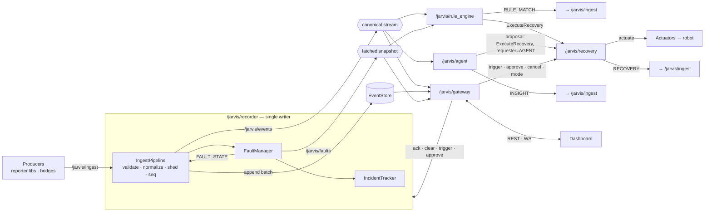
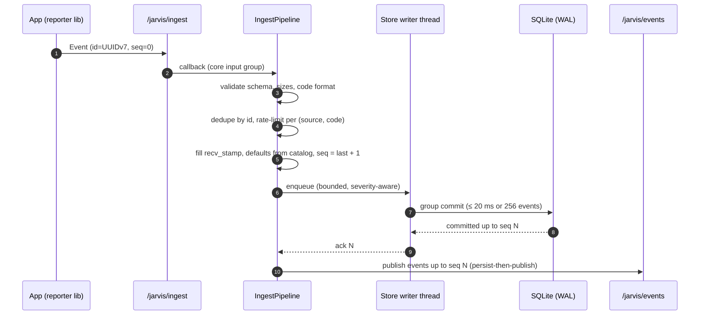
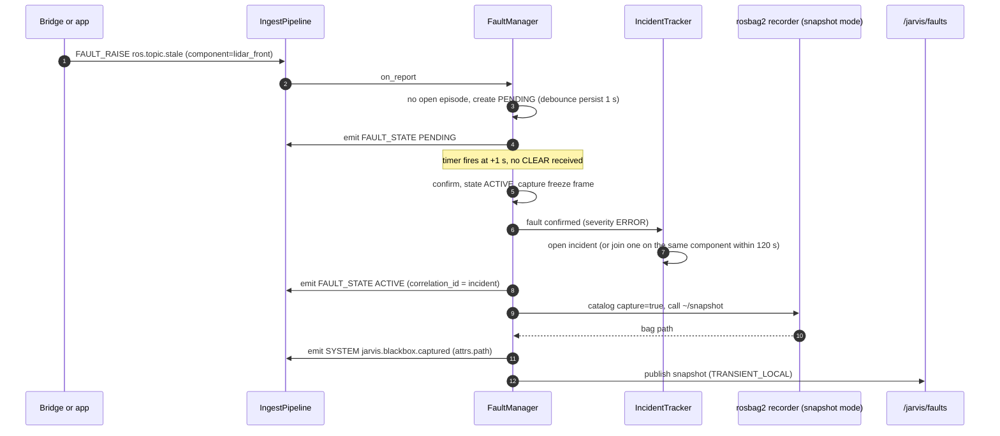
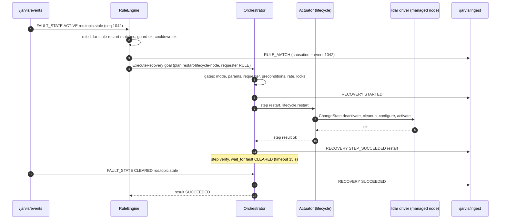
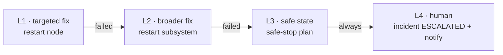
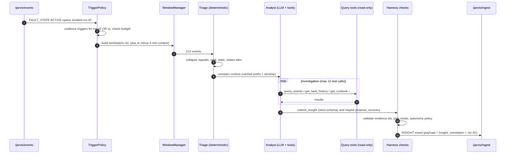
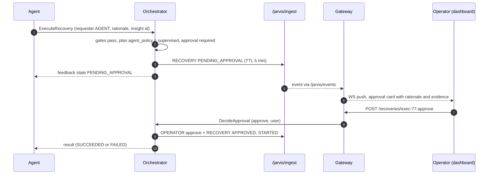
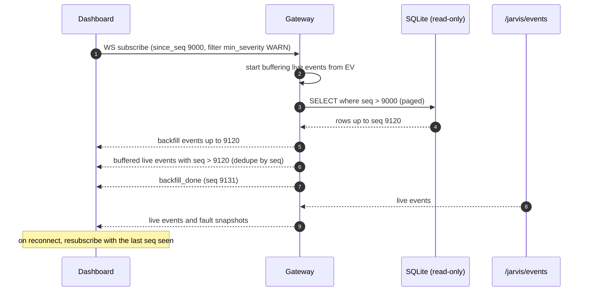
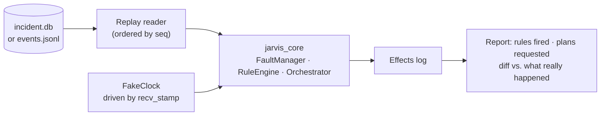

# 04 — Data Flow

> **TL;DR** — Producers publish to `/jarvis/ingest`. The recorder validates, persists and then
> republishes on `/jarvis/events`. Every decision Jarvis makes (fault transitions, rule matches,
> recovery steps, insights) loops back through the recorder as a new event, with `causation_id`
> pointing at its cause. The dashboard and the agent read the same log.

---

## 0. Big picture

## 1. Ingest

Details:
- **Rejections** (bad schema, oversize, depth > 16) produce a rate-limited `jarvis.ingest.rejected` SYSTEM event that carries the reason.
- **Suppression**: after the token bucket empties, the pipeline counts instead of storing, then emits one `jarvis.ingest.suppressed` event (`attrs.code`, `attrs.count`, `attrs.window_s`).
- **Load shedding**: when the writer queue is above the high-water mark, DEBUG and then INFO are dropped and counted. ≥ ERROR always enqueues; if needed the producer callback blocks briefly.

## 2. Fault confirmation, incident & black box

## 3. Rule match → recovery → verify → escalate

When verification times out, the escalation ladder runs:

## 4. Agent analysis

## 5. Agent proposal with approval (supervised autonomy)

If nobody decides before the TTL, the execution ends as `EXPIRED`. Nothing runs.

## 6. Dashboard live stream with gap-free resume

## 7. Offline replay & backtesting

- `jarvis backtest --rules ./rules --plans ./plans --events incident.db`
- Actuators are replaced by a **simulated actuator** that returns the outcomes recorded in the log (or `success`, configurable).
- The same harness is used for **regression tests**: every incident fixed in the field becomes a test case.

## 8. Delivery guarantees

| Path | Guarantee | Mechanism |
|------|-----------|-----------|
| Producer → recorder | At-least-once while the recorder is up | RELIABLE QoS, KEEP_LAST 1000, de-duplication by `id` |
| Recorder → store | Exactly-once per `id` | UNIQUE(`id`), transaction per batch |
| Store → `/jarvis/events` | In-order, persisted first | Publish after commit, monotonic `seq` |
| `/jarvis/events` → consumers | Gap-detectable | Consumers track `seq` and backfill via `query_events` |
| Orchestrator actions | At-most-once per step attempt | No automatic resume after a crash (`jarvis.recovery.interrupted`) |
| Gateway WS | Gap-free on reconnect | `since_seq` resume protocol |
