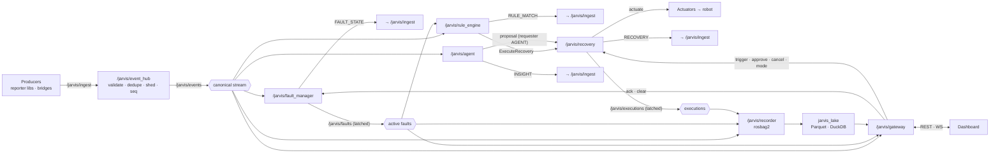
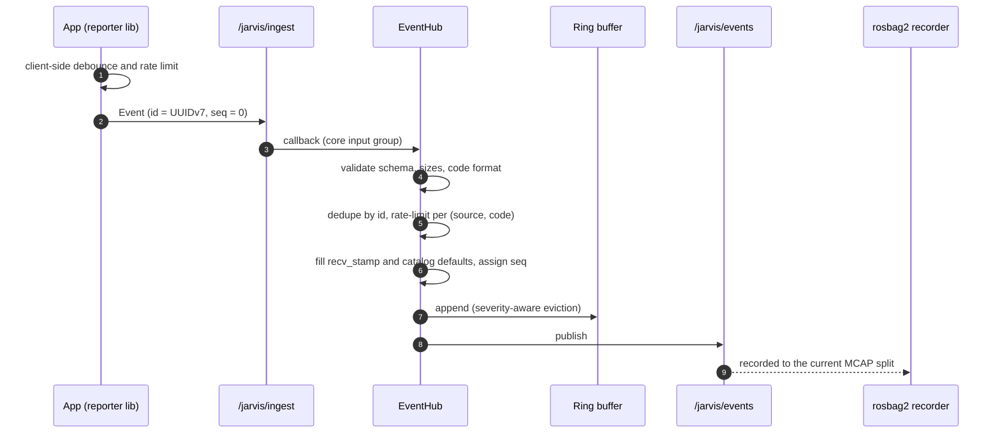
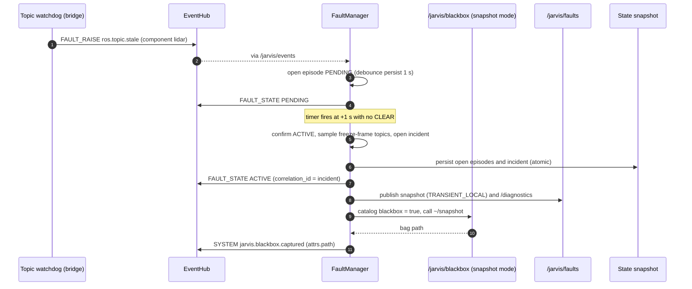
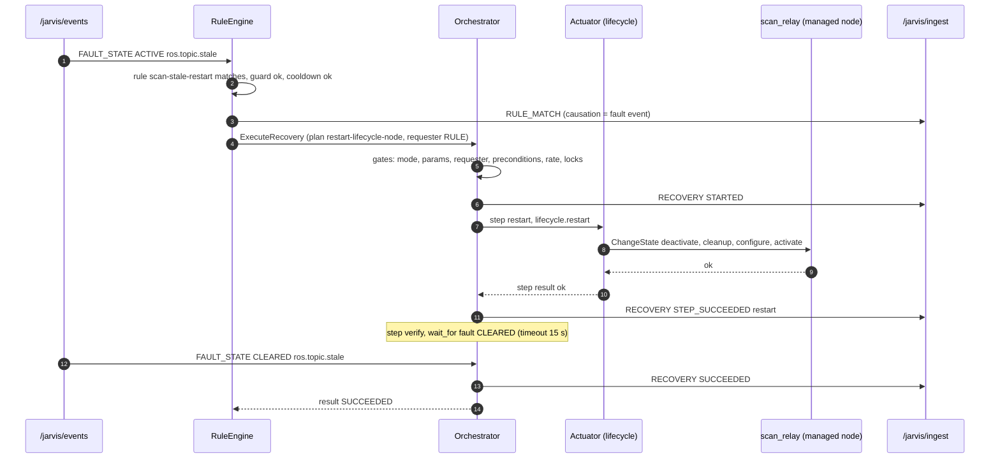
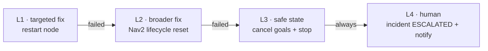
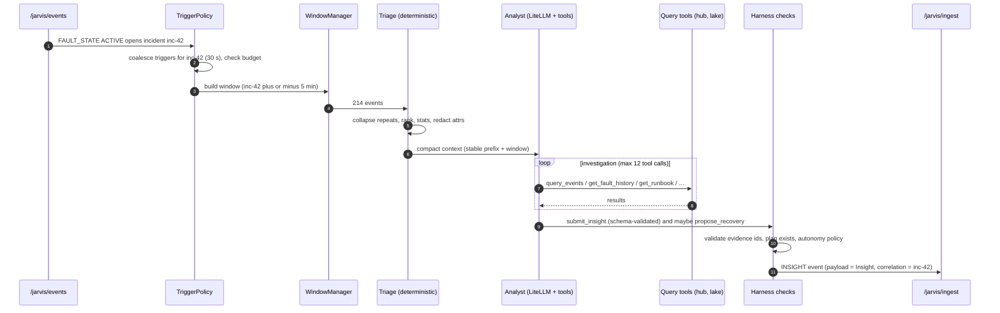
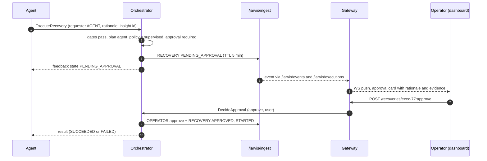
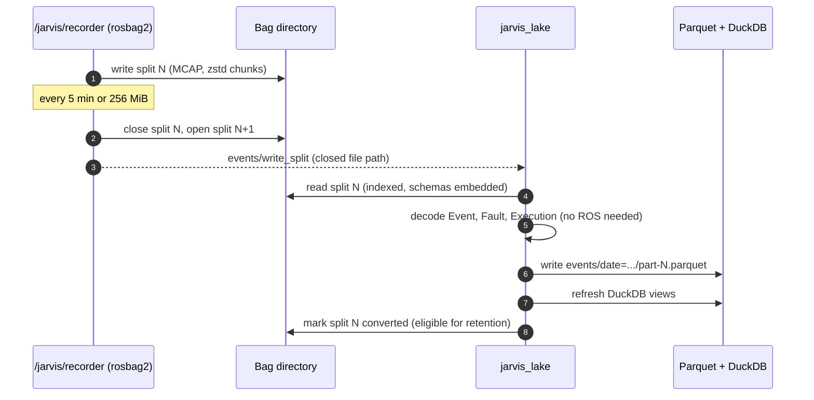
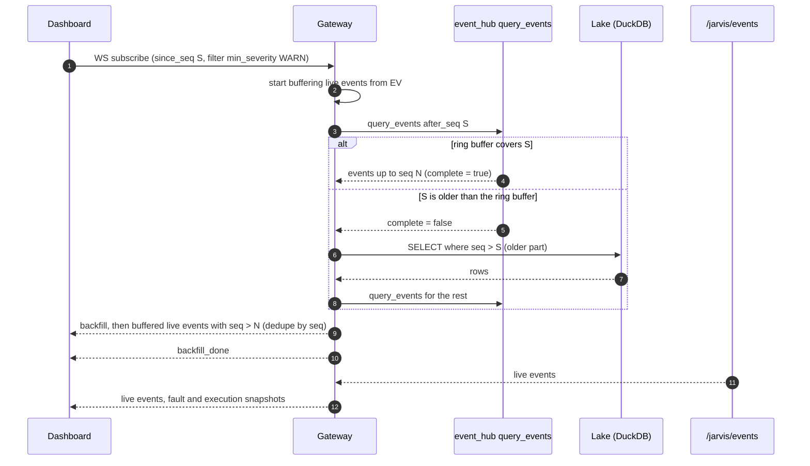
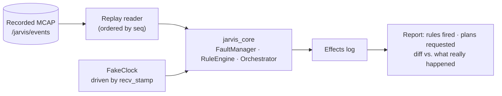

# 04 — Data Flow

> **TL;DR** — Producers publish to `/jarvis/ingest`. The event hub validates, sequences and republishes on
> `/jarvis/events`. Every decision Jarvis makes (fault transitions, rule matches, recovery steps, insights)
> loops back through the hub as a new event, with `causation_id` pointing at its cause. rosbag2 records the
> stream, and the lake turns recordings into queryable Parquet.

---

## 0. Big picture

## 1. Ingest

- **Rejections** (bad schema, oversize, causal depth > 16) produce a rate-limited `jarvis.ingest.rejected` event with the reason.
- **Suppression**: once the token bucket is empty, the hub counts instead of forwarding, then emits one `jarvis.ingest.suppressed` event (`attrs.code`, `attrs.count`, `attrs.window_s`).
- **Load shedding**: above the high-water mark, DEBUG and then INFO are dropped and counted. ≥ ERROR is always forwarded.

## 2. Fault confirmation, incident & black box

Correlation: if `safety.estop.engaged` is ACTIVE and `drive.*` faults confirm within 1 s, they are marked `muted_by` the e-stop episode. They're still recorded, but hidden from the active list, and cleared together with it.

## 3. Rule match → recovery → verify → escalate

When verification times out, the escalation ladder runs:

## 4. Agent analysis

## 5. Agent proposal with approval (supervised autonomy)

If nobody decides before the TTL, the execution ends as `EXPIRED`. Nothing runs.

## 6. Recording → lake

On startup the lake also scans for splits it hasn't converted yet, including unfinalized ones left by a crash. Those are recovered first.

## 7. Dashboard live stream with gap-free resume

## 8. Offline replay & backtesting

- `jarvis backtest --rules ./rules --plans ./plans --bag ./bags/2026-10-13/`
- Actuators are replaced by a **simulated actuator** that returns the outcomes recorded in the bag (or `success`, configurable).
- Every incident fixed in the field becomes a regression test: keep its bag, assert the decisions.

## 9. Delivery guarantees

| Path | Guarantee | Mechanism |
|------|-----------|-----------|
| Producer → hub | At-least-once while the hub is up | RELIABLE QoS, KEEP_LAST 1000, de-dupe by `id` |
| Hub → `/jarvis/events` | In-order, sequenced | Single publisher, monotonic `seq` |
| `/jarvis/events` → consumers | Gap-detectable | Consumers track `seq` and backfill via `query_events` / lake |
| `/jarvis/events` → bag | Recorded unless the process dies (last chunk ≤ ~1 s at risk) | Recorder in the same container, RELIABLE, MCAP recovery |
| Open faults / executions | Survive restarts and power cuts | fsynced atomic state snapshots |
| Orchestrator actions | At-most-once per step attempt | No automatic resume after a crash (`jarvis.recovery.interrupted`) |
| Gateway WS | Gap-free on reconnect | `since_seq` resume across ring buffer and lake |
