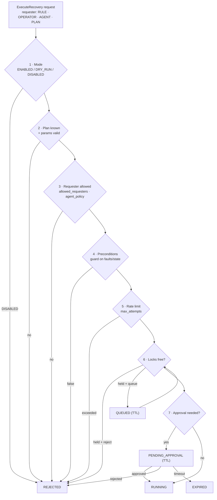
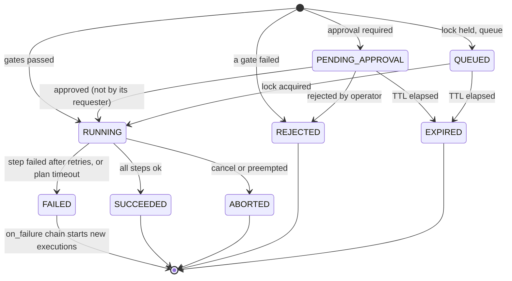

# 05 — Rules & Recovery

> **TL;DR**
> - **Rules** = `when` (pattern over events) + `guard` (current state) + `then` (actions) + `policy` (cooldown, limits, dry-run).
> - Patterns: `event`, `count`, `sequence` (with `absent` steps), `all`, `any`. Matching is per partition (e.g. per component).
> - **Plans** = ordered steps (`action`, `timeout`, `retry`) with a verification step and an `on_failure` escalation chain.
> - Every recovery request passes the **same 7 gates**, whoever sent it.
> - New rules roll out in **dry-run (shadow) mode** and are **backtested** on recorded incidents.

---

## 1. Rule file format

```yaml
schema: jarvis.rules/v1
rules:
  - id: lidar-stale-restart              # unique, kebab-case
    description: Lidar topic stale → restart its driver.
    labels: { subsystem: perception, owner: perception-team }
    enabled: true
    dry_run: false                       # true = record matches, run no actions (shadow mode)
    partition_by: [source.component]     # one matcher instance per component
    when:   { … pattern … }
    guard:  { … state conditions … }     # optional
    then:   [ … actions … ]
    policy: { cooldown: 30s, max_fires: { count: 3, per: 1h } }
```

Files are loaded from `config/rules/*.yaml`, parsed strictly by the core (unknown keys are errors; `schemas/rules.schema.json` describes the format for editors), and hot-reloaded atomically through `~/reload`. Recipes: the [rules cookbook](../guides/rules-cookbook.md).

## 2. Matchers

A matcher selects events. All listed fields must match (AND).

```yaml
event:
  kind: FAULT_STATE                 # enum
  code: ros.topic.*                 # glob (* and ?) on dotted codes
  severity: ">=ERROR"               # comparison on the severity order
  source.component: { glob: "lidar_*" }
  attrs.state: ACTIVE               # any attribute by path
  attrs.expected_hz: { gte: 5 }
  tags: [perception]                # event has all of these tags
```

| Operator | Example | Meaning |
|----------|---------|---------|
| scalar | `code: nav.localization.lost` | Equals (strings with `*`/`?` become globs) |
| `in` | `{ in: [ACTIVE, LATCHED] }` | One of |
| `not` | `{ not: MANUAL }` | Not equal (or `not: { in: [...] }`) |
| `glob` | `{ glob: "/sensors/*/scan" }` | Explicit glob |
| `regex` | `{ regex: "^lidar_(front\|rear)$" }` | ECMAScript regex, searched anywhere in the value: anchor it with `^…$` |
| `gt` `gte` `lt` `lte` | `{ lt: 0.2 }` | Numeric comparison |
| `exists` | `{ exists: true }` | Attribute present |
| severity string | `">=WARN"`, `"<ERROR"` | Severity order |

## 3. Patterns (`when`)

| Pattern | Shape | Fires when |
|---------|-------|-----------|
| `event` | `event: <matcher>` | One matching event arrives |
| `count` | `count: { event: <matcher>, threshold: N, within: T }` | N matching events within a sliding window T |
| `sequence` | `sequence: { within: T, steps: [ … ] }` | Steps match **in order**, all within T of the first. Unrelated events in between are ignored. |
| `absent` (step) | `{ absent: <matcher>, for: T }` | Inside a sequence: **no** matching event for T after the previous step (timer driven) |
| `all` | `all: { within: T, of: [ patterns ] }` | All sub-patterns match, in any order, within T |
| `any` | `any: [ patterns ]` | Any sub-pattern matches |

### Semantics (exact)

- **Time base**: `recv_stamp` by default (one monotonic event-hub clock, so no cross-host clock skew). Per rule, `time_basis: source` switches to `stamp`.
- **Order**: events are processed in `seq` order, the same order everywhere (live, replay, backtest).
- **Partitioning**: `partition_by` keys (`source.component`, `source.node`, `attrs.<key>`, …) create independent matcher instances. If no key is given, there is a single global instance.
- **Selection**: skip-till-next-match. Each partition holds **at most one partial match per rule**. The earliest start wins. After the rule fires, the partition's partial matches are reset.
- **Bounded state**: partial matches expire after `within`. Count windows keep at most `threshold` timestamps. Every partition is evicted after 10 × `within` of inactivity. Partitions are capped per rule (default 1 000) and the oldest is evicted.
- **Timers**: `absent` steps and expirations use the injected clock, so sim time and replay both work.
- **Self-loop protection**: a rule never matches an event whose causal chain contains its own `RULE_MATCH`. The global causal depth is limited to 16.

## 4. Guards (`guard`)

Guards are evaluated at fire time against the **current state**: the active fault snapshot plus the latest `STATE` values.

```yaml
guard:
  faults_active:   [power.battery.low]           # all must be ACTIVE/LATCHED
  faults_inactive: [safety.estop.engaged]        # none may be ACTIVE/LATCHED
  state:
    robot.mode:     { in: [AUTONOMOUS] }         # latest STATE event value
    mission.status: RUNNING
```

## 5. Actions (`then`)

| Action | Example | Effect |
|--------|---------|--------|
| `recover` | `{ recover: { plan: restart-lifecycle-node, args: { node: "{{ event.attrs.node }}" } } }` | `ExecuteRecovery` goal (requester `RULE`) |
| `emit` | `{ emit: { kind: FAULT_RAISE, code: drive.motor.overcurrent_burst, severity: ERROR, message: "…" } }` | Derived event, e.g. a composite fault |
| `incident` | `{ incident: { open: true } }` / `{ incident: { escalate: true } }` | Open or escalate the incident. `open` inside a live incident changes nothing; on a matched fault below the incident threshold it opens that fault's incident; otherwise it opens one on the event's component that later faults join and an operator closes. `escalate` needs the match to be in an incident |
| `notify` | `{ notify: { channel: ops, message: "…" } }` | `jarvis.notify` event, delivered by the gateway |
| `ask_agent` | `{ ask_agent: { focus: "Mechanical binding or tuning?" } }` | `jarvis.agent.request` event |

**Templating** uses `{{ … }}` interpolation only, with no logic. Available variables: `event` (last matched event), `steps.<id>` (sequence steps), `count`, `partition.<key>`, `rule.id`, `robot`. A template that renders empty makes the action fail validation at fire time; this is recorded and the action does not run.

## 6. Policy

| Field | Default | Meaning |
|-------|---------|---------|
| `cooldown` | `0s` | Minimum time between fires per partition |
| `max_fires` | none | `{ count, per }` per partition. When exceeded, the rule is suppressed for the rest of the window and emits `jarvis.rule.suppressed` (WARN), which **other rules can match on** to escalate. |
| `priority` | `0` | Ordering when several rules fire on the same event (higher first) |
| `dry_run` | `false` | Shadow mode: `RULE_MATCH` is recorded with `attrs.dry_run=true` and no actions run |

## 7. Rule examples (Nav2 simulation demo)

```yaml
schema: jarvis.rules/v1
rules:
  # 1. Single event → targeted recovery
  - id: scan-stale-restart
    description: /scan went stale → restart the scan relay (managed node).
    partition_by: [source.component]
    when:
      event: { kind: FAULT_STATE, code: ros.topic.stale, attrs.state: ACTIVE, attrs.topic: /scan }
    guard: { faults_inactive: [safety.estop.engaged] }
    then:
      - recover: { plan: restart-lifecycle-node, args: { node: "{{ event.attrs.node }}", component: "{{ event.source.component }}" } }
    policy: { cooldown: 30s, max_fires: { count: 3, per: 1h } }

  # 2. Escalate when the rule above keeps firing
  - id: scan-restart-exhausted
    when:
      event: { kind: SYSTEM, code: jarvis.rule.suppressed, attrs.rule: scan-stale-restart }
    then:
      - recover: { plan: safe-stop }
      - incident: { escalate: true }
      - notify: { channel: ops, message: "Lidar keeps stalling on {{ robot }}. Navigation stopped." }

  # 3. Count in window → clear costmaps + ask the agent (action status bridge input)
  - id: nav-goal-aborts
    when:
      count: { event: { kind: FAULT_RAISE, code: ros.action.navigate_to_pose.aborted }, threshold: 3, within: 5m }
    then:
      - recover: { plan: clear-costmaps }
      - ask_agent: { focus: "Why does NavigateToPose keep aborting? Planner, controller or map?" }
    policy: { cooldown: 2m }

  # 4. Sequence with absence: "relocalization didn't fix it"
  - id: localization-unrecoverable
    when:
      sequence:
        within: 90s
        steps:
          - id: lost
            event: { kind: FAULT_STATE, code: nav.localization.lost, attrs.state: ACTIVE }
          - id: tried
            event: { kind: RECOVERY, attrs.plan: relocalize, attrs.phase: { in: [SUCCEEDED, FAILED] } }
          - id: still_lost
            absent: { kind: FAULT_STATE, code: nav.localization.lost, attrs.state: CLEARED }
            for: 20s
    then:
      - recover: { plan: safe-stop }
      - incident: { escalate: true }

  # 5. Nav2 server dropped out of its lifecycle → reset the Nav2 stack
  - id: nav2-server-error
    partition_by: [source.component]
    when:
      event: { kind: FAULT_STATE, code: ros.lifecycle.failed, attrs.state: ACTIVE,
               source.component: { in: [controller_server, planner_server, bt_navigator, behavior_server] } }
    then:
      - recover: { plan: nav2-reset }
    policy: { cooldown: 60s, max_fires: { count: 2, per: 1h }, dry_run: true }   # shadow mode first
```

## 8. Recovery plans

```yaml
schema: jarvis.plans/v1
plans:
  - id: restart-lifecycle-node
    description: Cycle a managed node and verify its fault clears.
    params:
      node:      { type: string, required: true, pattern: "^/" }
      component: { type: string, required: true }
    locks: ["node:{{ params.node }}"]          # mutual exclusion key(s)
    on_conflict: reject                         # reject | queue (queue_ttl: 30s)
    allowed_requesters: [RULE, OPERATOR, AGENT]
    agent_policy: autonomous                    # never | advise | supervised | autonomous
    requires_approval: []                       # e.g. [RULE] to make rule-triggered runs wait for a human
    preconditions: { faults_inactive: [safety.estop.engaged] }
    max_attempts: { count: 5, per: 1h }
    timeout: 90s
    steps:
      - id: restart
        action: lifecycle.restart
        with: { node: "{{ params.node }}" }
        timeout: 20s
        retry: { attempts: 2, backoff: 2s, multiplier: 2.0 }
      - id: verify
        action: wait_for
        with: { fault: { code: ros.topic.stale, component: "{{ params.component }}" }, state: CLEARED }
        timeout: 15s
    on_failure:
      - run: { plan: nav2-reset }
      - escalate: operator

  - id: nav2-reset
    description: Reset and restart the Nav2 stack through its lifecycle manager.
    locks: [nav2]
    agent_policy: supervised
    steps:
      - { id: reset,   action: nav2.manage_lifecycle, with: { manager: /lifecycle_manager_navigation, command: RESET },   timeout: 20s }
      - { id: startup, action: nav2.manage_lifecycle, with: { manager: /lifecycle_manager_navigation, command: STARTUP }, timeout: 30s }
      - id: verify
        action: wait_for
        with: { event: { kind: STATE, code: nav.stack.state, attrs.value: ACTIVE } }
        timeout: 20s
    on_failure:
      - run: { plan: safe-stop }
      - escalate: operator

  - id: clear-costmaps
    locks: [nav2]
    agent_policy: autonomous
    steps:
      - { id: local,  action: nav2.clear_costmaps, with: { which: local },  timeout: 5s }
      - { id: global, action: nav2.clear_costmaps, with: { which: global }, timeout: 5s }

  - id: relocalize
    agent_policy: supervised
    steps:
      - { id: reinit, action: service.empty, with: { service: /reinitialize_global_localization }, timeout: 5s }
      - id: verify
        action: wait_for
        with: { fault: { code: nav.localization.lost, component: amcl }, state: CLEARED }
        timeout: 30s

  - id: safe-stop
    description: Cancel navigation goals and wait until the robot is still.
    allowed_requesters: [RULE, OPERATOR, AGENT, PLAN]   # PLAN: reached from nav2-reset's ladder
    agent_policy: supervised
    steps:
      - { id: cancel, action: nav2.cancel_navigation, timeout: 5s }
      - id: still
        action: wait_for
        with: { event: { kind: STATE, code: robot.motion, attrs.value: STOPPED } }
        timeout: 10s
    on_failure:
      - escalate: operator
```

### Step fields

| Field | Default | Meaning |
|-------|---------|---------|
| `id` | required | Unique within the plan |
| `action` | required | Registered action name (validated at load) |
| `with` | `{}` | Action arguments, checked by the actuator when the recovery node loads the plans (`jarvis lint` doesn't see them) |
| `timeout` | `10s` | Per attempt |
| `retry` | none | `{ attempts, backoff, multiplier }` |
| `when` | none | Guard. If false, the step is **skipped** (recorded) |
| `continue_on_failure` | `false` | Keep going even if this step fails |

Plan fields: `params` (`type: string | int | number | bool`, `required`, `default`, `pattern`, `one_of`), `locks`, `on_conflict: reject | queue` with `queue_ttl` (default `30s`), `allowed_requesters` (default: all four), `agent_policy` (default `advise`), `requires_approval`, `preconditions`, `max_attempts`, `timeout` (default `5m`), `steps`, `on_failure`. Templates in plans can use `params.<name>`, `plan.id`, `execution.id`, `correlation_id` and `robot`. A string that is exactly one `{{ var }}` keeps the parameter's type (`{{ params.enable }}` of a `bool` parameter is `true`, not `"true"`).

### Execution semantics (exact)

- **Steps run in order.** A step with a false `when` is recorded as `SKIPPED`. A failed attempt is retried after `backoff × multiplier^(attempt−1)`, up to `retry.attempts` more times. When a step fails for good, the execution is `FAILED`, unless the step has `continue_on_failure`. A rendering error (an unresolved template) fails the step without retrying.
- **`wait_for` looks back.** It also matches events received since the *previous* step started, so an effect visible before the actuator reports back still counts. The `fault` form checks the fault table instead: `CLEARED` holds once no open fault matches `code` (glob) and `component`; `ACTIVE` holds while one is `ACTIVE` or `LATCHED`.
- **`check` with `retry` polls.** Each attempt evaluates the guard once.
- **`run` starts a sub-plan** with requester `PLAN`. The sub-plan holds its parent's locks (no self-deadlock) and runs in its parent's `max_concurrent` slot. Its own `timeout` applies, not the step's. Its outcome is the step's outcome: its `on_failure` ladder does **not** run, because the parent handles the failure.
- **The `on_failure` ladder** runs when a top-level execution ends `FAILED`. Entries run in order. A `run` entry starts a new execution (requester `PLAN`, same correlation). If it **succeeds**, the ladder stops: recovered. If it fails, is rejected or expires, its own ladder runs first, then this ladder continues with the next entry. If it is aborted, the ladder stops (a human or the kill switch intervened). `escalate` raises the incident to `ESCALATED` and happens at most once per chain, so nested ladders never page twice. With the examples above, L1 `restart-lifecycle-node` → L2 `nav2-reset` → L3 `safe-stop` → L4 `escalate: operator` is exactly the ladder in [04 · Data flow §3](04-data-flow.md).
- **Plan timeout** (from `RUNNING`) fails the execution and cancels the step in flight.
- **Dry run** (`DRY_RUN` mode, or `dry_run: true` on the request): every gate runs, approval is noted but not awaited, every step succeeds immediately as `simulated`, and no actuator is called. Its events carry `attrs.dry_run=true` and never change incidents. Dry-run attempts count against their own `max_attempts` history, not the live one.
- **Restart.** `PENDING_APPROVAL` and `QUEUED` executions survive a restart, along with ladders in progress, rate-limit history and the mode. `RUNNING` executions are not resumed. They end `ABORTED` with `jarvis.recovery.interrupted`, their incident is escalated, and the ladder they belong to stops. A waiting execution whose plan changed (content hash `plan_rev`) is rejected, both after a restart and after a reload.
- **Events.** Every transition is a `RECOVERY` event `jarvis.recovery.<phase>` with `attrs.phase` set to one of the following:
  - lifecycle: `PENDING_APPROVAL`, `QUEUED`, `APPROVED`, `STARTED`;
  - steps: `STEP_SKIPPED`, `STEP_RETRYING`, `STEP_SUCCEEDED`, `STEP_FAILED`;
  - outcome: `SUCCEEDED`, `FAILED`, `ABORTED`, `REJECTED`, `EXPIRED`;
  - escalation: `ESCALATED`, `LADDER_DONE`.

  The event also carries `attrs.plan`, `attrs.execution_id`, `attrs.requester`, `attrs.dry_run` and, for sub-plans, `attrs.parent_id`. An execution's first event also carries its arguments, `attrs.arg.<name>` (at most 16, 256 bytes each), so history tells two runs of a plan apart. Only top-level, non-dry-run executions move incident states. Each event's `causation_id` is the previous event of the same execution, and the first one points at the request's cause (e.g. the `RULE_MATCH`).

### Action catalog (v1)

| Action | Provided by | Arguments | Behavior |
|--------|-------------|-----------|----------|
| `wait_for` | core | `event: <matcher>` **or** `fault: {code, component}, state` | Succeeds when matched, fails on timeout |
| `delay` | core | `duration` | Sleep (clock-aware) |
| `check` | core | guard | Fails if the guard is false |
| `emit` | core | event fields | Emits an event |
| `run` | core | `plan`, `args` | Sub-plan (depth ≤ 3, cycles rejected at load) |
| `lifecycle.transition` | jarvis_ros | `node`, `transition` | `lifecycle_msgs/srv/ChangeState` |
| `lifecycle.restart` | jarvis_ros | `node` | Reads `GetState`, then walks to `active` through `deactivate → cleanup → configure → activate` |
| `service.trigger` | jarvis_ros | `service` | `std_srvs/srv/Trigger`. `success=false` fails the step. |
| `service.set_bool` | jarvis_ros | `service`, `data` | `std_srvs/srv/SetBool` |
| `service.empty` | jarvis_ros | `service` | `std_srvs/srv/Empty` |
| `service.call` | jarvis_ros | `service`, `type`, `request`, `expect` | Any service, of the type named (`pkg/srv/Name`). `request` sets its fields; the response must hold `expect` (default: `success: true` when it has a boolean `success`) |
| `action.goal` | jarvis_ros | `action`, `type`, `goal`, `expect` | Any action (`pkg/action/Name`): sends the goal, waits for the result, which must be `SUCCEEDED` and hold `expect`. A step timeout cancels the goal |
| `param.set` | jarvis_ros | `node`, `name`, `value` | `rcl_interfaces/srv/SetParameters` |
| `bag.snapshot` | jarvis_ros | `service` | rosbag2 `~/snapshot` |
| `container.restart` | jarvis_ros | `container`, `stop_timeout_s` | Docker Engine API (Podman's compatible socket too): unpauses a paused container, restarts it, waits until it runs (and is healthy, with a healthcheck). Only containers in the recovery node's `containers.allowed` |
| `systemd.restart` | jarvis_ros | `unit`, `user` | `systemctl [--user] restart`, then waits for `is-active`; a failed unit fails the step. Only units in `systemd.allowed_units` |
| `nav2.manage_lifecycle` | jarvis_nav2 (plugin) | `manager`, `command` | `nav2_msgs/srv/ManageLifecycleNodes` (STARTUP / PAUSE / RESUME / RESET / SHUTDOWN) |
| `nav2.clear_costmaps` | jarvis_nav2 (plugin) | `which: local\|global\|both` (default both) | `nav2_msgs/srv/ClearEntireCostmap` |
| `nav2.cancel_navigation` | jarvis_nav2 (plugin) | `actions` (optional list) | Cancels all `NavigateToPose` / `NavigateThroughPoses` goals; succeeds when no server is up |
| `nav2.navigate_to_pose` | jarvis_nav2 (plugin) | `pose: {x, y, yaw}`, `frame` (default map) | Sends a goal and waits for the result (e.g. go to dock); a step timeout cancels it |
| `<vendor>.<name>` | **pluginlib** | plugin-defined | Custom actuators (`jarvis_ros::Actuator` base class) |

`service.call` and `action.goal` load their types by name (C++ introspection type support, through `rclcpp::GenericClient` and `rclcpp_action::GenericClient`), so the recovery node checks `request`, `goal` and `expect` against them when it loads the plans: an unknown type or field, a value of the wrong type, an integer out of range fail the load. Templates are checked once rendered.

Planned later: `process.restart` (systemd over D-Bus), `bt.run` (BehaviorTree.CPP).

## 9. The gates (admission control)



Each gate result is stored on the execution for the audit trail. In `DRY_RUN` mode every gate runs, but steps are only **simulated**, and events carry `attrs.dry_run=true`.

**Agent autonomy** (gate 3 + gate 7): `effective = min(deployment agent.autonomy, plan.agent_policy)`.

| Effective level | What happens to an agent proposal |
|-----------------|-----------------------------------|
| `never` / `observe` | Rejected at gate 3 |
| `advise` | Not submitted. Shown on the dashboard as a recommendation with a "run" button (that run is an `OPERATOR` request). |
| `supervised` | Submitted → `PENDING_APPROVAL` |
| `autonomous` | Submitted → runs if gates 4–6 pass **and** `confidence ≥ agent.min_confidence` (default 0.8) |

## 10. Execution state machine



## 11. Safety model

1. **Not in the safety chain.** Certified safety functions stay independent. Plans should use `preconditions` to stand down while safety faults are active.
2. **One gate.** Rules, operators and the agent all go through `ExecuteRecovery`. The agent owns no actuators.
3. **Closed world for actions.** Only registered actions; arguments are schema-validated; plans are validated at load (unknown action, bad template variable, recursion, missing verification step → error or warning).
4. **Anti-storm.** Cooldowns, `max_fires`, `max_attempts`, locks, a global `max_concurrent` (default 4), plan timeouts and depth limits.
5. **Kill switch.** `~/set_mode DISABLED` from the dashboard, CLI or ROS. It takes effect immediately and cancels running executions when `cancel_running: true`.
6. **Safe rollout.** `dry_run` (shadow) per rule, `DRY_RUN` mode globally, and `jarvis backtest` against recorded incidents before enabling.
7. **Full audit.** Who requested, why (`rationale`), which gates passed, each step, outcome, and who approved.
8. **Four-eyes.** An operator may not approve a run they requested, nor its sub-plans or `on_failure` ladder: each execution records who started its chain (`on_behalf_of`), and `decide` refuses that operator ("alice requested this run: another operator must approve it"). Withdrawing (rejecting) one's own request is allowed. Names compare without case or surrounding blanks. A rule's or the agent's request is nobody's: any operator approves it. `separate_approver: false` on the recovery component turns it off, for a team of one.

## 12. Tooling

| Tool | Purpose |
|------|---------|
| `jarvis lint [--rules DIR] [--plans DIR] [--catalog FILE]` | Parses everything, then cross-checks: rules that recover with unknown plans, plans that refuse RULE requests, missing or unknown arguments, unknown actions, cycles, plans that never verify, watched faults missing from the catalog. ROS-free (`jarvis_core`); `ros2 jarvis lint` wraps it. |
| `jarvis backtest --rules DIR [--plans DIR] [--expect-same] EVENTS.jsonl` | Replays recorded events through the rules (and, with `--plans`, the plans in dry run) and compares every decision with the ones recorded live (`rule <- cause`). The live engines' own events are recomputed, not replayed. `--expect-same` makes a difference an exit code (for CI). |
| `ros2 jarvis export BAG [-o FILE]` · `ros2 jarvis backtest BAG --rules DIR` | A recorded bag's events (`/jarvis/event_batches`, or `/jarvis/events` in bags before 1.0) as JSON Lines (the schema's format), or straight into a backtest |
| `ros2 jarvis rules [list\|reload [--check]\|enable\|disable\|dry-run] [ids] [--off] [--operator] [--reason]` · `ros2 jarvis plans [list\|reload [--check]]` | Operate rules and plans live |
| `ros2 jarvis recover <plan> [-a k=v] [--dry-run]` | Operator-triggered recovery through the gates, with step feedback |
| `ros2 jarvis mode [ENABLED\|DRY_RUN\|DISABLED] [--cancel-running]` | Kill switch (no argument: show the mode) |
| `ros2 jarvis executions [--steps]` · `approve` · `reject` · `cancel` · `faults` | What runs and waits, decisions, open faults |
