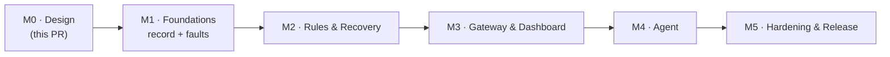

# 09 — Roadmap, Milestones & Test Strategy

> **TL;DR** — 5 milestones. Each one ends with a working, demoable slice and green CI.
> M1 records faults (in a Nav2 simulation) → M2 recovers automatically → M3 shows it in a dashboard → M4 explains it with the agent → M5 hardens it.

---

## Milestones

### M1 — Foundations: record & manage faults
| PR | Content |
|----|---------|
| 1.1 | Repo scaffolding: colcon layout, `pre-commit`, Dockerfile + devcontainer, CI (ROS-free core job + Jazzy `action-ros-ci`), CODEOWNERS, contributing guide |
| 1.2 | `schemas/` (Event, Fault, catalog) + codegen setup (Python/TS) + `jarvis_interfaces` |
| 1.3 | `jarvis_core`: domain types, ports, EventHub, FaultManager (incl. DEM counter debounce, correlation), IncidentTracker (pure, gtest, sanitizers) |
| 1.4 | `jarvis_ros`: type adapters, clock, state snapshot files, `event_hub` + `fault_manager` lifecycle components, services, latched `/jarvis/faults`, `/diagnostics` export |
| 1.5 | Recording: `rosbag2_transport::Recorder` component config (MCAP, splits, QoS overrides) + black-box recorder (snapshot mode) |
| 1.6 | `jarvis_reporter` (C++ + Python) + `jarvis_bridges` (diagnostics, rosout, action status) |
| 1.7 | `jarvis_demo`: Gazebo + Nav2 TB4 simulation, `scan_relay` lifecycle node, fault injector, `launch_testing` e2e |

**Exit**: in the Nav2 simulation, injected faults (scan stall, aborted goal, diagnostics ERROR, rosout errors) appear on `/jarvis/events` and `/jarvis/faults` with correct debounce, heal and latch; they're recorded to MCAP and open in Foxglove; open faults survive a `fault_manager` restart.

### M2 — Rules & recovery
| PR | Content |
|----|---------|
| 2.1 | Rule DSL schema + parser + `jarvis lint` |
| 2.2 | CEP engine: `event`, `count`, `sequence`, `absent`, `all`, `any`, partitions, policies (exhaustive gtest + property tests) |
| 2.3 | Plan DSL + orchestrator: gates, locks, rate limits, approvals, steps, escalation, dry-run |
| 2.4 | ROS components: `rule_engine`, `recovery` (`ExecuteRecovery` server, latched `/jarvis/executions`), actuators (lifecycle, std_srvs, params, bag snapshot), pluginlib base |
| 2.4b | `jarvis_nav2`: Nav2 actuator plugins (lifecycle manager, clear costmaps, cancel/send goals) |
| 2.5 | Bridges: lifecycle bridge, topic watchdog (QoS events + rate), node watchdog |
| 2.6 | `jarvis backtest` + `jarvis_cli` (`ros2 jarvis …`) |
| 2.7 | Demo: S1 and S2 in `jarvis_demo` (rules, `inject scan-wedge`, recoveries in the live view), launch test and Docker smoke test |

**Exit**: e2e in simulation — `/scan` stalls → rule fires → `scan_relay` restarts → fault clears → `SUCCEEDED`. Repeated aborts clear costmaps. Exhaustion escalates to `safe-stop` (goals cancelled). Backtest on the recorded bag reproduces the same decisions.

**Where it stands**: the first half and the backtest run on every PR, without a simulator (`jarvis_demo` launch test, Docker smoke test): a wedged relay is restarted (`SUCCEEDED`), a stall the restart can't fix fails its check and escalates, a fourth restart in ten minutes is suppressed and escalated, and the recording replays to the same decisions. The Nav2 half (costmap clears, `safe-stop`) needs the Gazebo simulation: it comes with the nightly scenario suite.

### M3 — Gateway & dashboard
| PR | Content |
|----|---------|
| 3.0 ✔ | `jarvis_lake`: MCAP → Parquet on `write_split`, crash recovery of unfinalized splits, DuckDB views, retention; KPIs and analytics (health per component, Pareto of fault codes, heatmap, flapping faults, plan effectiveness) |
| 3.1 ✔ | Gateway: REST read API (event hub + lake), LAN binding + role tokens, OpenAPI, Prometheus, bag listing |
| 3.2 ✔ | Gateway: WS stream with gap-free resume; command endpoints (ack/clear/recover/approve/mode); webhook notifier |
| 3.3 ✔ | Dashboard shell, Overview, Live events, Faults |
| 3.4 ✔ | Incident timeline, Recovery (approvals), Rules, System |
| 3.5 ✔ | Playwright e2e against the demo |

**Exit**: operator can see, ack, clear, trigger, approve and kill-switch from the browser. Every action is audited.

### M4 — Agent
| PR | Content |
|----|---------|
| 4.1 ✔ | Agent core: triggers, windows, triage, context builder, heuristic analyst (no LLM) |
| 4.2 ✔ | LiteLLM adapter: tool loop, `submit_insight` + repair turn, model capability check, budgets/cost, traces, hash-pinned dependency |
| 4.3 ✔ | Harness checks + autonomy policy + proposals through `ExecuteRecovery` |
| 4.4 ✔ | ROS node (`Analyze` action) + gateway `/agent/ask` (SSE) + dashboard Agent view |
| 4.5 ✔ | Eval corpus from demo scenarios + graders + nightly job |

**Exit**: on a demo incident the agent posts an insight with valid evidence within 60 s. In `supervised` mode a proposal can be approved from the dashboard.

### M5 — Hardening & release
| PR | Content |
|----|---------|
| 5.1 ✔ | Load and soak tests against the NFR targets: `jarvis-bench` (the core, ROS-free) and `jarvis_load` (the stack), a CI smoke test and a nightly soak; the fixes they called for (bounded incidents, the isolated container, burst-deep queues). Measured in [01-requirements §5](01-requirements.md#5-non-functional-requirements) |
| 5.2 | Batched event stream (group commit): one message per batch on `/jarvis/events`, for NFR-1's 10 000 events/s and NFR-5's footprint |
| 5.3 ✔ | Crash durability and disk pressure: unchunked recording, a SIGKILL test (faults, `seq` and recordings survive), a free-disk floor in the lake and `jarvis.storage.low`. Measured in [01-requirements §5](01-requirements.md#measured-53) |
| 5.4 ✔ | Security: an SROS2 profile (one enclave per process, tested enforced), gateway TLS and single sign-on through an authenticating proxy, a redaction audit of the agent (redaction where it reads, secrets scrubbed from every message). [Security guide](../guides/security.md) |
| 5.5 ✔ | Docs: [integration guide](../guides/integration.md), [rules cookbook](../guides/rules-cookbook.md) (every recipe linted in CI), [operator guide](../guides/operator.md), runbooks: a template and one per shipped fault code, served from the catalog to the dashboard and the agent (`get_runbook`) |
| 5.6 | Release: versioned Docker images, bloom-ready packages, CHANGELOGs, quality declaration |

### Later (v2+)
Fleet (Parquet to object storage) & fleet dashboard · real-robot bring-up (ARM64) · ros2_medkit interop bridge · MCP server exposing Jarvis queries to AI assistants · visual rule editor with live backtest · generic `action.goal` / `service.call` actuators · BehaviorTree.CPP actuator · Foxglove panel · Zenoh/MQTT transports for non-ROS producers.

## Demo scenarios (Nav2 simulation)

| # | Inject (fault injector) | Detected by | Expected Jarvis response |
|---|-------------------------|-------------|--------------------------|
| S1 | Wedge `scan_relay` (it stops forwarding `/scan` until restarted) | The relay's own report → `sensor.scan.stale` (or the topic watchdog → `ros.topic.stale`) | Restart `scan_relay` → verify → `SUCCEEDED`. A stall a restart can't fix: verify fails → `ESCALATED`, notification |
| S2 | Repeat S1 four times in ten minutes | `jarvis.rule.suppressed` | Incident `ESCALATED`, notification (with Nav2: `safe-stop` too) |
| S3 | Block the path so `NavigateToPose` aborts 3× | Action status bridge → `ros.action.navigate_to_pose.aborted` | Clear costmaps + agent insight |
| S4 | Teleport the robot (kidnapping) | Localization monitor diagnostics → `nav.localization.lost` | `relocalize` → if still lost after 20 s: `safe-stop` + escalate |
| S5 | Kill `controller_server` | Lifecycle bridge / Nav2 lifecycle manager diagnostics | `nav2-reset` (shadow mode first, then enabled) |
| S6 | rosout ERROR storm from one node | rosout bridge | Suppression summary, no flood in the dashboard |
| S7 | Simulated e-stop | Reporter `safety.estop.engaged` (CRITICAL, latched) | All recoveries blocked by preconditions; symptoms muted; operator clear required |

Each scenario is a `launch_testing` case (nightly with Gazebo) and a recorded bag for backtesting.

---

## Test strategy

| Layer | Tooling | What we prove |
|-------|---------|---------------|
| Core unit | gtest + `FakeClock`, ASan/UBSan | Every pattern/policy/gate/state transition. Table-driven, deterministic. |
| Core property | rapidcheck (or a hand-rolled generator) | Bounded state, no lost matches, order invariance across partitions |
| Contracts | JSON Schema ↔ C++ codec ↔ pydantic ↔ `.msg` parity | One contract, no drift |
| Persistence | gtest/pytest on real files | State snapshot atomicity (kill -9 mid-write), bag → Parquet conversion, unfinalized MCAP recovery, retention |
| ROS integration | `launch_testing` + `jarvis_demo` | Every PR: end-to-end flows from [04-data-flow](04-data-flow.md) with lightweight fakes (no Gazebo), on Fast DDS + Cyclone. Nightly: full Gazebo + Nav2 scenario suite (headless). |
| Backtest / regression | `jarvis backtest` on recorded incidents | Same log ⇒ same decisions |
| Agent | pytest + `FakeLLM`; eval suite | Harness checks, policy, budgets; quality via evals |
| Gateway | pytest + httpx + WS client | API contract, auth, resume protocol |
| UI | Vitest + Playwright | Views, approval flow, live updates |
| Performance | Google Benchmark + soak scripts | NFR-1…5 on x86 (ARM64 later) |

## Definition of done (every PR)
- [ ] CI green (lint, build, tests, sanitizers where applicable)
- [ ] New behavior covered by tests at the lowest possible layer
- [ ] Docs/ADRs updated if behavior or contracts changed
- [ ] No `rclcpp`/`rclpy` in `core/`
- [ ] Schemas and `.msg` parity test passing
