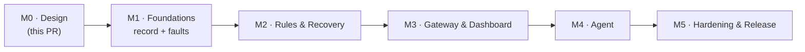

# 09 — Roadmap, Milestones & Test Strategy

> **TL;DR** — 5 milestones. Each one ends with a working, demoable slice and green CI.
> M1 records faults (in a Nav2 simulation) → M2 recovers automatically → M3 shows it in a dashboard → M4 explains it with the agent → M5 hardens it.

---

## Milestones

### M1 — Foundations: record & manage faults
| PR | Content |
|----|---------|
| 1.1 | Repo scaffolding: colcon layout, `pre-commit`, Dockerfile + devcontainer, CI (ROS-free core job + Jazzy `action-ros-ci`), CODEOWNERS, contributing guide |
| 1.2 | `schemas/` (Event, Fault, catalog) + codegen setup (Python/TS) + `jarvis_interfaces` |
| 1.3 | `jarvis_core`: domain types, ports, EventHub, FaultManager (incl. DEM counter debounce, correlation), IncidentTracker (pure, gtest, sanitizers) |
| 1.4 | `jarvis_ros`: type adapters, clock, state snapshot files, `event_hub` + `fault_manager` lifecycle components, services, latched `/jarvis/faults`, `/diagnostics` export |
| 1.5 | Recording: `rosbag2_transport::Recorder` component config (MCAP, splits, QoS overrides) + black-box recorder (snapshot mode) |
| 1.6 | `jarvis_reporter` (C++ + Python) + `jarvis_bridges` (diagnostics, rosout, action status) |
| 1.7 | `jarvis_demo`: Gazebo + Nav2 TB4 simulation, `scan_relay` lifecycle node, fault injector, `launch_testing` e2e |

**Exit**: in the Nav2 simulation, injected faults (scan stall, aborted goal, diagnostics ERROR, rosout errors) appear on `/jarvis/events` and `/jarvis/faults` with correct debounce, heal and latch; they're recorded to MCAP and open in Foxglove; open faults survive a `fault_manager` restart.

### M2 — Rules & recovery
| PR | Content |
|----|---------|
| 2.1 | Rule DSL schema + parser + `jarvis lint` |
| 2.2 | CEP engine: `event`, `count`, `sequence`, `absent`, `all`, `any`, partitions, policies (exhaustive gtest + property tests) |
| 2.3 | Plan DSL + orchestrator: gates, locks, rate limits, approvals, steps, escalation, dry-run |
| 2.4 | ROS components: `rule_engine`, `recovery` (`ExecuteRecovery` server, latched `/jarvis/executions`), actuators (lifecycle, std_srvs, params, bag snapshot), pluginlib base |
| 2.4b | `jarvis_nav2`: Nav2 actuator plugins (lifecycle manager, clear costmaps, cancel/send goals) |
| 2.5 | Bridges: lifecycle bridge, topic watchdog (QoS events + rate), node watchdog |
| 2.6 | `jarvis backtest` + `jarvis_cli` (`ros2 jarvis …`) |
| 2.7 | Demo: S1 and S2 in `jarvis_demo` (rules, `inject scan-wedge`, recoveries in the live view), launch test and Docker smoke test |

**Exit**: e2e in simulation — `/scan` stalls → rule fires → `scan_relay` restarts → fault clears → `SUCCEEDED`. Repeated aborts clear costmaps. Exhaustion escalates to `safe-stop` (goals cancelled). Backtest on the recorded bag reproduces the same decisions.

**Where it stands**: the first half and the backtest run on every PR, without a simulator (`jarvis_demo` launch test, Docker smoke test): a wedged relay is restarted (`SUCCEEDED`), a stall the restart can't fix fails its check and escalates, a fourth restart in ten minutes is suppressed and escalated, and the recording replays to the same decisions. The Nav2 half (costmap clears, `safe-stop`) needs the Gazebo simulation: it comes with the nightly scenario suite.

### M3 — Gateway & dashboard
| PR | Content |
|----|---------|
| 3.0 ✔ | `jarvis_lake`: MCAP → Parquet on `write_split`, crash recovery of unfinalized splits, DuckDB views, retention; KPIs and analytics (health per component, Pareto of fault codes, heatmap, flapping faults, plan effectiveness) |
| 3.1 ✔ | Gateway: REST read API (event hub + lake), LAN binding + role tokens, OpenAPI, Prometheus, bag listing |
| 3.2 ✔ | Gateway: WS stream with gap-free resume; command endpoints (ack/clear/recover/approve/mode); webhook notifier |
| 3.3 ✔ | Dashboard shell, Overview, Live events, Faults |
| 3.4 ✔ | Incident timeline, Recovery (approvals), Rules, System |
| 3.5 ✔ | Playwright e2e against the demo |

**Exit**: operator can see, ack, clear, trigger, approve and kill-switch from the browser. Every action is audited.

### M4 — Agent
| PR | Content |
|----|---------|
| 4.1 ✔ | Agent core: triggers, windows, triage, context builder, heuristic analyst (no LLM) |
| 4.2 ✔ | LiteLLM adapter: tool loop, `submit_insight` + repair turn, model capability check, budgets/cost, traces, hash-pinned dependency |
| 4.3 ✔ | Harness checks + autonomy policy + proposals through `ExecuteRecovery` |
| 4.4 ✔ | ROS node (`Analyze` action) + gateway `/agent/ask` (SSE) + dashboard Agent view |
| 4.5 ✔ | Eval corpus from demo scenarios + graders + nightly job |

**Exit**: on a demo incident the agent posts an insight with valid evidence within 60 s. In `supervised` mode a proposal can be approved from the dashboard.

### M5 — Hardening & release
| PR | Content |
|----|---------|
| 5.1 ✔ | Load and soak tests against the NFR targets: `jarvis-bench` (the core, ROS-free) and `jarvis_load` (the stack), a CI smoke test and a nightly soak; the fixes they called for (bounded incidents, the isolated container, burst-deep queues). Measured in [01-requirements §5](01-requirements.md#5-non-functional-requirements) |
| 5.2 ✔ | Batched event stream (group commit): the hub publishes `/jarvis/event_batches`, a message per 5 ms or 500 events, read by Jarvis's components, the recorder and the gateway; `/jarvis/events` only while someone reads it; producers can batch too (`/jarvis/ingest_batches`). 10 000 events/s, nothing lost, p99 13 ms (was: 5 % delivered); the gateway keeps up. Measured in [01-requirements §5](01-requirements.md#measured-51) |
| 5.3 ✔ | Crash durability and disk pressure: unchunked recording, a SIGKILL test (faults, `seq` and recordings survive), a free-disk floor in the lake and `jarvis.storage.low`. Measured in [01-requirements §5](01-requirements.md#measured-53) |
| 5.4 ✔ | Security: an SROS2 profile (one enclave per process, tested enforced), gateway TLS and single sign-on through an authenticating proxy, a redaction audit of the agent (redaction where it reads, secrets scrubbed from every message). [Security guide](../guides/security.md) |
| 5.5 ✔ | Docs: [integration guide](../guides/integration.md), [rules cookbook](../guides/rules-cookbook.md) (every recipe linted in CI), [operator guide](../guides/operator.md), runbooks: a template and one per shipped fault code, served from the catalog to the dashboard and the agent (`get_runbook`) |
| 5.6 (prepared) | Release: one version for every package (`scripts/version.py`, checked in CI), changelogs (`CHANGELOG.md`, a `CHANGELOG.rst` per package), a tag-triggered workflow publishing versioned Docker images and the GitHub release, bloom-ready package metadata, a [quality declaration](../../QUALITY_DECLARATION.md) and a [security policy](../../SECURITY.md). The release itself is a tag: [RELEASING.md](../../RELEASING.md) |

### M6 — Interop & operations
Where the field is going (October 2026): diagnostics converging on SOVD (ISO 17978: ros2_medkit, its Foxglove panel, VDA 5050 fleet managers), AI assistants reaching robots over MCP (servers so far expose the raw graph, not faults or incidents), and fleets run by small teams that need guardrails more than dashboards.

| PR | Content |
|----|---------|
| 6.1 ✔ | Four-eyes approvals: nobody approves a run they asked for, nor its sub-plans or `on_failure` ladder (`on_behalf_of`); the dashboard offers *Withdraw* instead; `separate_approver: false` for a team of one |
| 6.2 ✔ | MCP server (`jarvis_mcp`, [guide](../guides/ai-assistants.md)): AI assistants read faults, incidents, runbooks, events, recoveries and analytics through the gateway (its tokens, roles and audit), ask the agent, and, if allowed, request a recovery through the gates |
| 6.3 ✔ | SOVD surface ([guide](../guides/sovd.md)): the gateway serves Jarvis's faults at `/sovd/api/v1`, with the paths and fields of ros2_medkit's gateway (ISO 17978): the entity tree, faults listed, in detail, live (server-sent events) and cleared through the gates. The unmodified ros2_medkit web UI connects to it |
| 6.4 ✔ | ros2_medkit faults into Jarvis (`jarvis_medkit`, `medkit:=true`, [guide](../guides/integration.md#already-running-ros2_medkit)): what medkit's fault manager confirms, updates and clears becomes Jarvis faults (`medkit.<code>`), with a periodic resync for missed events and a reconcile at start, so a robot running medkit gets Jarvis's rules, recovery and agent on top |

### M7 — Platforms & fleets
Where it is going next (October 2026): ROS 2 Lyrical Luth, the new LTS (May 2026, Ubuntu 26.04), next to Jazzy; graph-level checks that catch what ROS keeps quiet (ros2_medkit 0.7 added QoS, orphan-topic and parameter-drift watchdogs); fleet managers that speak VDA 5050 and want robots' errors in its state; and fleets small teams watch from one place.

| PR | Content |
|----|---------|
| 7.1 ✔ | QoS watchdog: a subscription whose QoS its publisher cannot match gets nothing, silently. `ros.topic.qos_incompatible` per topic, from the QoS of every endpoint on the graph (rmw's own check), with which pair and why; it clears once they match |
| 7.2 ✔ | ROS 2 Lyrical Luth (LTS): the ROS packages built and tested on Lyrical in CI (Ubuntu 26.04, Python 3.14), next to Jazzy. The Docker image stays on Jazzy (`ROS_DISTRO` builds another) |
| 7.3 ✔ | VDA 5050 ([guide](../guides/vda5050.md)): Jarvis's open root causes as VDA 5050 error objects (`GET /api/v1/vda5050/errors`), for the robot's adapter to merge into its state: levels from severity and latch (3.0, or 2.x), predefined types by mapping, the runbook's first fix as the hint |
| 7.4 ✔ | Fleet view ([guide](../guides/fleet.md)): a gateway lists other robots' gateways (`fleet` in gateway.yaml) and its dashboard shows them side by side, worst first: online, open faults by severity, the worst one, the recovery mode; a click opens the robot's own dashboard. Read-only; `GET /api/v1/fleet` |

### M8 — Act on anything, hear from anything
Where it goes from here (October 2026): robots run more than Nav2 (vendor drivers with their own services, Nav2's docking server, behavior trees, processes outside ROS) and more than ROS (BMSs, chargers, PLCs and microcontrollers that speak MQTT). Every recovery a team needs shouldn't wait for someone to write an actuator in C++, nor every device for someone to write a ROS driver.

| PR | Content |
|----|---------|
| 8.1 ✔ | Generic actuators: `service.call` and `action.goal` drive any service or action of a type named in the plan, with the request or goal in YAML and `expect` on the response or result; checked against the type when the plans load ([cookbook](../guides/rules-cookbook.md#14-any-service-or-action-no-actuator-to-write)). The demo's docking scenario (`docking.launch.py`) docks through Nav2's `DockRobot` and re-seeds AMCL with no actuator written |
| 8.2 ✔ | MQTT for devices that don't run ROS ([guide](../guides/mqtt.md), `jarvis_mqtt`, `mqtt:=true`): a BMS, a charger, a PLC report faults, states and logs as JSON (`<prefix>/devices/<device>/report`), the device as the component; their last will raises `mqtt.device.offline`; Jarvis's open faults go back out retained (`<prefix>/robots/<robot>/faults`) for HMIs and PLCs; `allow` keeps devices to their codes |
| 8.3 ✔ | Rule lab ([operator guide](../guides/operator.md#7-rules)): write a rule or change one in the dashboard and backtest it over the robot's recorded history before it goes live (`POST /api/v1/rules:backtest`). The events of the last hours to 7 days, replayed through `jarvis backtest` with the robot's other rules and its plans in dry run: when the draft would have fired and on which event, its rate limits and guards, the recoveries it would have asked for, and, for a rule the robot runs, every decision that differs from what it decided live |
| 8.4 ✔ | Rule suggestions ([operator guide](../guides/operator.md#7-rules)): what operators keep doing by hand becomes a rule. Each recovery an operator ran is tied to the fault it answered (its incident, else the fault its args name); runs of the same plan after the same fault, with args from the fault as templates, are a suggestion once there are two, unless a rule already does it (`GET /api/v1/rules:suggest`). The rule lab lists them with the runs behind them (who, where, how long after the fault, how it ended) and drafts the rule, backtested over those runs. An execution's first event now carries its args (`attrs.arg.<name>`) |
| 8.5 ✔ | Restart what isn't a lifecycle node ([guide](../guides/containers.md)): `container.restart` (the Docker Engine API, Podman's compatible socket too: unpause, restart, wait until running and healthy) and `systemd.restart` (`systemctl restart`, then `is-active`), only for the containers and units the recovery node allows (`containers.allowed`, `systemd.allowed_units`, empty by default); shipped plans `restart-container` and `restart-systemd-unit`; `params_overlay:=` layers a few parameters over `jarvis.yaml`. The demo's container scenario (`containers.launch.py`): the lidar driver runs in a container and Jarvis restarts it when it hangs |
| 8.6 ✔ | Maintenance windows ([operator guide](../guides/operator.md#maintenance-hands-off-one-component)): an operator puts a component under maintenance for up to a week (dashboard header or a fault's wrench, `ros2 jarvis maintenance lidar 30m`, `POST /api/v1/maintenance`). Until it ends, the requester gate refuses rules' and the agent's recoveries on it (operators and running ladders go on), and the gateway silences notifications about it. A banner on every page; `jarvis.maintenance.started` / `.ended` on the record; persisted with the orchestrator's state, ended on time even across a restart |
| 8.7 ✔ | Behavior trees ([guide](../guides/behavior-trees.md), `jarvis_bt`): `bt.run` runs a BehaviorTree.CPP 4 tree as a recovery step, from the recovery node's `bt.trees_dir`, with its blackboard from the step, behind the plan's gates, lock, timeout and audit; the step's message says what each named branch did and why the last failure failed. Jarvis nodes for any tree: `JarvisCallService` and `JarvisSendGoal` (any service or action, types by name), `JarvisFaultActive` and `JarvisWaitFaultCleared` (Jarvis's open faults); also a BT plugin library (`jarvis_bt_nodes`) for a robot's own trees, e.g. Nav2's. Ships `restart_lifecycle_node.xml`; the demo's tree scenario (`trees.launch.py`) |
| 8.8 ✔ | Build a rule ([operator guide](../guides/operator.md#7-rules)): a rule from a form in the rule lab, no YAML. A fault and its state (or any event), on a component, optionally N times within a window; not while a safety fault is open; run a plan (its arguments filled from the fault), notify, open or escalate the incident, ask the agent; per component, cooldown, rate limit, shadow mode on by default. The YAML is shown as it is built, backtested as if live, and opens in the YAML editor for what the form doesn't cover |

### M9 — On real robots
Jarvis has run on laptops, in CI and in Docker. Robots are ARM64 boards that boot unattended, with a disk that fills, a clock that may not be set, and a team that needs to know Jarvis is ready before the robot drives off.

| PR | Content |
|----|---------|
| 9.1 ✔ | Robot bring-up ([guide](../guides/robot.md)): ARM64 built and tested in CI on a native ARM runner (ROS 2 Jazzy, and the Docker demo's smoke test); release images for amd64 and arm64 under one tag, each built natively; a systemd unit and its settings file (`jarvis_bringup/systemd`: its own user, after the time sync, SIGINT then 30 s, restart on failure); `ros2 jarvis doctor`: the nodes and their lifecycle state, the recovery mode, plans, rules, open faults, the data disk, the recorder, the clock's sync and the gateway, each problem with its fix, exit code 1 on a problem, `--json` |
| 9.2 ✔ | History off the robot ([fleet guide §4](../guides/fleet.md#4-the-fleets-history)): the lake uploads its Parquet, and the black box's snapshots if asked, as they are complete, to S3 or any S3 API (MinIO, Ceph) or a mounted share (`lake_upload_to`, pyarrow's file systems: no new dependency); a ledger across restarts, oldest first, a time budget per pass, backoff while offline; retention keeps what is not uploaded unless the disk runs short (then counted as lost); `jarvis.upload.behind` past a max lag; the System page shows it; `jarvis-lake fleet` queries every robot's history in place with the lake's views and a `robot` column |
| 9.3 ✔ | The fleet's history in the dashboard ([fleet guide §4](../guides/fleet.md#4-the-fleets-history)): a gateway that knows where the robots upload (`fleet.history`) shows it on the Fleet page, over 24 h, 7 or 30 days: per robot, confirmed faults, MTTR, incidents and escalations, recovered without a person, recovery success, how far its history goes; confirmed faults per robot per day; the codes that cost the fleet most and the robots they hit (`GET /api/v1/fleet/history`, read once a minute per window). `jarvis-lake demo-history` writes a made-up week for demo robots, to try it |
| 9.4 ✔ | Rules and plans from the fleet ([fleet guide §5](../guides/fleet.md#5-rules-and-plans-from-the-fleet), `jarvis_fleet`): `config_from:=s3://...` (or a share) and each robot takes its rules and plans from the fleet's storage, shared and per robot, layered by file name over the robot's own. A new revision settles, passes `jarvis lint`, then the recovery orchestrator's and the rule engine's own check, then loads (plans first), through an atomic switch of `<data_dir>/config/active`; anything failing goes back to the revision before. A refused revision raises `jarvis.config.rejected` and is not tried again; offline or empty, the robot keeps what it runs, and boots on it. `jarvis.config.applied` on the record; the System page shows the source, the revision, what was refused; its own SROS2 enclave |
| 9.5 ✔ | A rollout at a glance ([fleet guide §5](../guides/fleet.md#watch-a-rollout)): each robot's health carries where its rules and plans come from; the fleet view collects it, and the Fleet page shows which revision runs on which robots, which was refused where and why, and the robots on their own; each robot's card says it in one line (`config` in `GET /api/v1/fleet`) |
| 9.6 ✔ | Fleet alerts ([fleet guide §6](../guides/fleet.md#6-alerts-when-nobody-is-looking)): with `fleet.watch`, the gateway that lists the robots looks at them every `period_s` by itself and alerts its webhooks (channel `fleet`) when a robot has been unreachable for `offline_after_s` and when it is back, when it refuses the fleet's rules and plans and when it takes them again; the Fleet page lists the last alerts (`GET /api/v1/fleet/alerts`); `/metrics` has `jarvis_fleet_robot_online` and `jarvis_fleet_config_refused` per robot |

### M10 — Where robots are debugged
The people who debug robots do it in Foxglove or Lichtblick, with the robot's data in front of them: Jarvis belongs there too, not only in its own dashboard.

| PR | Content |
|----|---------|
| 10.1 ✔ | A Jarvis panel for Foxglove and Lichtblick ([guide](../guides/foxglove.md), `foxglove/jarvis-panel`): the open faults (`/jarvis/faults`) worst first, latched marked, over Jarvis's events (`/jarvis/event_batches`), from a minimum severity; live through foxglove_bridge, or on Jarvis's MCAP recordings, where the log is every event up to the playhead and a click on one seeks there. A `.foxe` built and tested in CI, attached to each release; one version with the rest (`scripts/version.py`) |

### Later (v2+)
Zenoh for non-ROS producers.

## Demo scenarios (Nav2 simulation)

| # | Inject (fault injector) | Detected by | Expected Jarvis response |
|---|-------------------------|-------------|--------------------------|
| S1 | Wedge `scan_relay` (it stops forwarding `/scan` until restarted) | The relay's own report → `sensor.scan.stale` (or the topic watchdog → `ros.topic.stale`) | Restart `scan_relay` → verify → `SUCCEEDED`. A stall a restart can't fix: verify fails → `ESCALATED`, notification |
| S2 | Repeat S1 four times in ten minutes | `jarvis.rule.suppressed` | Incident `ESCALATED`, notification (with Nav2: `safe-stop` too) |
| S3 | Block the path so `NavigateToPose` aborts 3× | Action status bridge → `ros.action.navigate_to_pose.aborted` | Clear costmaps + agent insight |
| S4 | Teleport the robot (kidnapping) | Localization monitor diagnostics → `nav.localization.lost` | `relocalize` → if still lost after 20 s: `safe-stop` + escalate |
| S5 | Kill `controller_server` | Lifecycle bridge / Nav2 lifecycle manager diagnostics | `nav2-reset` (shadow mode first, then enabled) |
| S6 | rosout ERROR storm from one node | rosout bridge | Suppression summary, no flood in the dashboard |
| S7 | Simulated e-stop | Reporter `safety.estop.engaged` (CRITICAL, latched) | All recoveries blocked by preconditions; symptoms muted; operator clear required |

Each scenario is a `launch_testing` case (nightly with Gazebo) and a recorded bag for backtesting.

---

## Test strategy

| Layer | Tooling | What we prove |
|-------|---------|---------------|
| Core unit | gtest + `FakeClock`, ASan/UBSan | Every pattern/policy/gate/state transition. Table-driven, deterministic. |
| Core property | rapidcheck (or a hand-rolled generator) | Bounded state, no lost matches, order invariance across partitions |
| Contracts | JSON Schema ↔ C++ codec ↔ pydantic ↔ `.msg` parity | One contract, no drift |
| Persistence | gtest/pytest on real files | State snapshot atomicity (kill -9 mid-write), bag → Parquet conversion, unfinalized MCAP recovery, retention |
| ROS integration | `launch_testing` + `jarvis_demo` | Every PR: end-to-end flows from [04-data-flow](04-data-flow.md) with lightweight fakes (no Gazebo), on Fast DDS + Cyclone. Nightly: full Gazebo + Nav2 scenario suite (headless). |
| Backtest / regression | `jarvis backtest` on recorded incidents | Same log ⇒ same decisions |
| Agent | pytest + `FakeLLM`; eval suite | Harness checks, policy, budgets; quality via evals |
| Gateway | pytest + httpx + WS client | API contract, auth, resume protocol |
| UI | Vitest + Playwright | Views, approval flow, live updates |
| Performance | Google Benchmark + soak scripts | NFR-1…5 on x86 (ARM64: functional tests in CI, not benchmarked) |

## Definition of done (every PR)
- [ ] CI green (lint, build, tests, sanitizers where applicable)
- [ ] New behavior covered by tests at the lowest possible layer
- [ ] Docs/ADRs updated if behavior or contracts changed
- [ ] No `rclcpp`/`rclpy` in `core/`
- [ ] Schemas and `.msg` parity test passing
