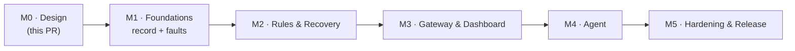

# 09 — Roadmap, Milestones & Test Strategy

> **TL;DR** — 5 milestones. Each one ends with a working, demoable slice and green CI.
> M1 records faults → M2 recovers automatically → M3 shows it in a dashboard → M4 explains it with the agent → M5 hardens it.

---

## Milestones

### M1 — Foundations: record & manage faults
| PR | Content |
|----|---------|
| 1.1 | Repo scaffolding: colcon layout, `pre-commit`, Dockerfile + devcontainer, CI (ROS-free core job + Jazzy `action-ros-ci`), CODEOWNERS, contributing guide |
| 1.2 | `schemas/` (Event, Fault, catalog) + codegen setup (Python/TS) + `jarvis_interfaces` |
| 1.3 | `jarvis_core`: domain types, ports, IngestPipeline, FaultManager, IncidentTracker (pure, gtest, sanitizers) |
| 1.4 | `jarvis_store_sqlite`: schema, migrations, batched writer, queries, retention |
| 1.5 | `jarvis_ros`: type adapters, clock, `recorder` lifecycle component, services, `/jarvis/faults` |
| 1.6 | `jarvis_reporter` (C++ + Python) + `jarvis_bridges` (diagnostics, rosout) |
| 1.7 | `jarvis_bringup` + `jarvis_demo` (fake lidar/battery nodes) + `launch_testing` e2e |

**Exit**: the demo robot's faults appear in SQLite, on `/jarvis/events` and in `/jarvis/faults`, with correct debounce, heal and latch.

### M2 — Rules & recovery
| PR | Content |
|----|---------|
| 2.1 | Rule DSL schema + parser + `jarvis lint` |
| 2.2 | CEP engine: `event`, `count`, `sequence`, `absent`, `all`, `any`, partitions, policies (exhaustive gtest + property tests) |
| 2.3 | Plan DSL + orchestrator: gates, locks, rate limits, approvals, steps, escalation, dry-run |
| 2.4 | ROS components: `rule_engine`, `recovery` (`ExecuteRecovery` server), actuators (lifecycle, std_srvs, params, bag snapshot), pluginlib base |
| 2.5 | Bridges: lifecycle bridge, topic watchdog (QoS events + rate), node watchdog |
| 2.6 | `jarvis backtest` + `jarvis_cli` (`ros2 jarvis …`) |

**Exit**: e2e test — the demo lidar stalls → rule fires → driver restarts → fault clears → `SUCCEEDED`. Exhaustion escalates to `safe-stop`. Backtest reproduces the same decisions from the recorded DB.

### M3 — Gateway & dashboard
| PR | Content |
|----|---------|
| 3.1 | Gateway: REST read API, auth/roles, OpenAPI, Prometheus |
| 3.2 | Gateway: WS stream with gap-free resume; command endpoints (ack/clear/recover/approve/mode); webhook notifier |
| 3.3 | Dashboard shell, Overview, Live events, Faults |
| 3.4 | Incident timeline, Recovery (approvals), Rules, System |
| 3.5 | Playwright e2e against the demo |

**Exit**: operator can see, ack, clear, trigger, approve and kill-switch from the browser. Every action is audited.

### M4 — Agent
| PR | Content |
|----|---------|
| 4.1 | Agent core: triggers, windows, triage, context builder, heuristic analyst (no LLM) |
| 4.2 | Claude adapter: tool loop, `submit_insight`, caching, budgets, traces |
| 4.3 | Harness checks + autonomy policy + proposals through `ExecuteRecovery` |
| 4.4 | ROS node (`Analyze` action) + gateway `/agent/ask` (SSE) + dashboard Agent view |
| 4.5 | Eval corpus from demo scenarios + graders + nightly job |

**Exit**: on a demo incident the agent posts an insight with valid evidence within 60 s. In `supervised` mode a proposal can be approved from the dashboard.

### M5 — Hardening & release
- Load and soak tests against the NFR targets (ingest, latency, memory), with flood/shedding tuning.
- Retention/eviction under disk pressure; power-cut durability test.
- SROS2 profile, TLS/OIDC guide, redaction audit.
- Docs: integration guide, rule cookbook, runbook templates, operator guide.
- Release: versioned Docker images, bloom-ready packages, CHANGELOGs, quality declaration.

### Later (v2+)
Fleet uplink & fleet dashboard · visual rule editor with live backtest · generic `action.goal` / `service.call` actuators · BehaviorTree.CPP actuator · Foxglove panel · Zenoh/MQTT transports for non-ROS producers.

---

## Test strategy

| Layer | Tooling | What we prove |
|-------|---------|---------------|
| Core unit | gtest + `FakeClock`, ASan/UBSan | Every pattern/policy/gate/state transition. Table-driven, deterministic. |
| Core property | rapidcheck (or a hand-rolled generator) | Bounded state, no lost matches, order invariance across partitions |
| Contracts | JSON Schema ↔ C++ codec ↔ pydantic ↔ `.msg` parity | One contract, no drift |
| Store | gtest on a real SQLite file | Migrations, group commit, crash-recovery (kill -9 during write), retention |
| ROS integration | `launch_testing` + `jarvis_demo` | End-to-end flows from [04-data-flow](04-data-flow.md) on Fast DDS + Cyclone |
| Backtest / regression | `jarvis backtest` on recorded incidents | Same log ⇒ same decisions |
| Agent | pytest + `FakeLLM`; eval suite | Harness checks, policy, budgets; quality via evals |
| Gateway | pytest + httpx + WS client | API contract, auth, resume protocol |
| UI | Vitest + Playwright | Views, approval flow, live updates |
| Performance | Google Benchmark + soak scripts | NFR-1…5 on x86 and ARM64 |

## Definition of done (every PR)
- [ ] CI green (lint, build, tests, sanitizers where applicable)
- [ ] New behavior covered by tests at the lowest possible layer
- [ ] Docs/ADRs updated if behavior or contracts changed
- [ ] No `rclcpp`/`rclpy` in `core/`
- [ ] Schemas and `.msg` parity test passing
