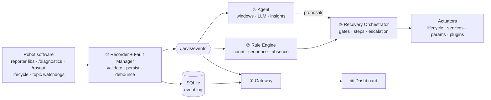

# Jarvis — Design Package

> **Status: PROPOSED.** Nothing is implemented yet. Review the **✅ Decisions to validate** table
> below. Once it's signed off, implementation starts at **M1** ([roadmap](09-roadmap.md)).

## TL;DR (60 seconds)

- **What** — An event, fault & recovery management system for ROS 2 robots: it **records** what goes wrong, **recovers automatically** using rules over sequences of events, **explains** with an AI agent, and **shows** everything on a live dashboard.
- **How** — A **ROS-agnostic core** (pure C++20 / Python) wrapped by **ROS 2 adapters**. ROS 2 is the transport, not the domain.
- **Idea 1 · Everything is an event.** Faults, rule matches, recovery steps, AI insights and operator clicks all go into one append-only log. Timelines and agent context come for free.
- **Idea 2 · One actuation gate.** Rules, humans and the agent all request recovery through the same orchestrator, with the same safety gates (mode, preconditions, locks, rate limits, approvals, kill switch).
- **Idea 3 · Deterministic core.** Decision logic is a pure state machine, so replaying a recorded incident yields the same decisions. This gives you rule backtesting and regression tests.

## The pieces

| # | Piece | Package(s) | Lang | One-liner |
|---|-------|------------|------|-----------|
| ① | Recorder + Fault Manager | `jarvis_core`, `jarvis_store_sqlite`, `jarvis_ros` | C++20 | Ingest → validate → persist → publish; fault lifecycle with debounce/heal/latch; incidents |
| ② | Rule Engine (CEP) | `jarvis_core`, `jarvis_ros` | C++20 | YAML rules over events, counts, sequences, absence → actions |
| ③ | Recovery Orchestrator | `jarvis_core`, `jarvis_ros` | C++20 | Plans with verify + escalation, behind 7 gates |
| ④ | Agent | `jarvis_agent` | Python | Event windows → triage → LLM with read-only tools → insights + gated proposals |
| ⑤ | Gateway + Dashboard | `jarvis_gateway`, `dashboard` | Python, TS | REST/WS API + web UI (incident timeline, approvals, …) |
| + | Inputs | `jarvis_bridges`, `jarvis_reporter` | C++/Py | Zero-code adoption via diagnostics/rosout/lifecycle/watchdogs, plus 1-line reporter API |

## Read in this order

| Doc | What's inside | Read time |
|-----|---------------|-----------|
| [01 · Requirements](01-requirements.md) | Goals, non-goals, FRs, NFR targets, glossary | 5 min |
| [02 · Architecture](02-architecture.md) | Hexagonal layers, packages, components, threading, deployments, failure modes | 8 min |
| [03 · Data model](03-data-model.md) | Event/Fault/Incident/Insight, ROS interfaces, QoS, SQLite schema | 10 min |
| [04 · Data flow](04-data-flow.md) | Sequence diagrams for every flow + delivery guarantees | 8 min |
| [05 · Rules & recovery](05-rules-and-recovery.md) | DSL spec, CEP semantics, plans, actions, gates, safety | 12 min |
| [06 · Agent](06-agent.md) | Triggers, windows, tools, LLM design, guardrails, autonomy, evals | 8 min |
| [07 · Dashboard](07-dashboard.md) | Gateway API, WS protocol, KPIs, wireframes for 8 views | 8 min |
| [08 · ROS 2 practices](08-ros2-practices.md) | Commercial-grade checklist and how Jarvis applies it | 5 min |
| [09 · Roadmap](09-roadmap.md) | Milestones M1–M5, PR breakdown, test strategy | 5 min |
| [ADRs](../adr/README.md) | One page per decision below | 1 min each |

## ✅ Decisions to validate

| # | Decision | Recommendation | Main alternative | ADR |
|---|----------|----------------|------------------|-----|
| D1 | Architecture | Hexagonal; ROS-free core; ROS 2 = adapter layer | Logic inside ROS nodes | [0001](../adr/0001-hexagonal-ros-agnostic-core.md) |
| D2 | Languages | C++20 runtime · Python agent/gateway · TS dashboard | All-Python (faster demo, weaker on robot) | [0002](../adr/0002-language-split.md) |
| D3 | Storage | Event log in SQLite WAL, single writer, persist-then-publish | Postgres/Timescale on robot | [0003](../adr/0003-event-log-sqlite-single-writer.md) |
| D4 | Contracts | JSON Schema canonical; `.msg` via type adapters | Protobuf / `.msg` as source | [0004](../adr/0004-json-schema-contracts.md) |
| D5 | Rules & plans | Declarative YAML DSL with CEP semantics | BehaviorTree.CPP / scripting | [0005](../adr/0005-declarative-rule-and-plan-dsl.md) |
| D6 | Actuation | Single gate (orchestrator); agent never actuates | Each requester actuates | [0006](../adr/0006-single-actuation-gate.md) |
| D7 | Agent | Provider port, Claude default, offline fallback, autonomy = `advise` | Rules only / local LLM | [0007](../adr/0007-agent-provider-port-and-autonomy.md) |
| D8 | UI | Standalone web dashboard behind a gateway | Foxglove panels | [0008](../adr/0008-web-dashboard-and-gateway.md) |
| D9 | Distro | ROS 2 Jazzy first | Humble first | [0009](../adr/0009-target-ros-distro.md) |

## ❓ Open questions (your answers change targets, not the architecture)

1. **Hardware**: x86, Jetson/Orin-class ARM64, or both? (Sets NFR targets and the CI arch matrix.)
2. **Connectivity & privacy**: can robots call a cloud LLM directly, or should the agent run off-board (topology B)?
3. **Existing stack**: Nav2? ros2_control? Do you already publish `/diagnostics`? (Decides which bridges and demo scenarios come first.)
4. **Dashboard exposure**: LAN-only, or reachable over the internet? (Decides auth scope for M3: tokens vs. OIDC.)
5. **Fleet**: still one robot for v1, with fleet as v2?
