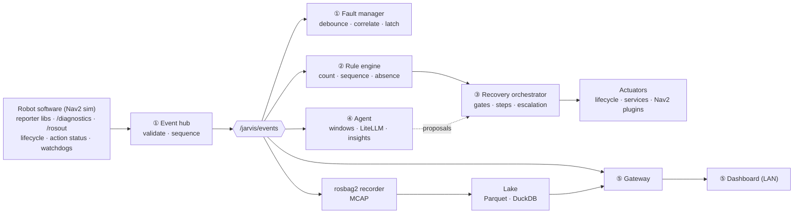

# Jarvis — Design Package

> **Status: ACCEPTED (rev 2, approved 2026-10-14).** Implementation is in progress, starting with **M1** ([roadmap](09-roadmap.md)).

## TL;DR (60 seconds)

- **What** — An event, fault & recovery management system for ROS 2 robots: it **records** what goes wrong, **recovers automatically** using rules over sequences of events, **explains** with an AI agent, and **shows** everything on a live dashboard.
- **How** — A **ROS-agnostic core** (pure C++20 / Python) wrapped by **ROS 2 adapters**. Everything Jarvis knows is published on the ROS graph and **recorded with rosbag2**. History comes from **Parquet + DuckDB**.
- **Idea 1 · Everything is an event.** Faults, rule matches, recovery steps, AI insights and operator clicks all go on one stream (`/jarvis/events`). Timelines and agent context come for free.
- **Idea 2 · One actuation gate.** Rules, humans and the agent all request recovery through the same orchestrator, with the same safety gates.
- **Idea 3 · Deterministic core.** Replaying a recorded bag yields the same decisions. This gives you rule backtesting and regression tests.

## The pieces

| # | Piece | Package(s) | Lang | One-liner |
|---|-------|------------|------|-----------|
| ① | Event hub + Fault manager | `jarvis_core`, `jarvis_ros` | C++20 | Validate and sequence events; fault lifecycle (debounce/heal/latch/correlate); incidents; `/diagnostics` export |
| ② | Rule engine (CEP) | `jarvis_core`, `jarvis_ros` | C++20 | YAML rules over events, counts, sequences, absence → actions |
| ③ | Recovery orchestrator | `jarvis_core`, `jarvis_ros`, `jarvis_nav2` | C++20 | Plans with verify + escalation, behind 7 gates |
| ④ | Agent | `jarvis_agent` | Python | Event windows → triage → LLM (LiteLLM) with read-only tools → insights + gated proposals |
| ⑤ | Gateway + Dashboard | `jarvis_gateway`, `dashboard` | Python, TS | REST/WS API + web UI on the LAN |
| + | Recording & history | rosbag2, `jarvis_lake` | config, Python | Continuous MCAP + black box; Parquet + DuckDB |
| + | Inputs | `jarvis_bridges`, `jarvis_reporter` | C++/Py | Zero-code adoption (diagnostics, rosout, lifecycle, action status, watchdogs) + 1-line reporter API |

## Read in this order

| Doc | What's inside | Read time |
|-----|---------------|-----------|
| [01 · Requirements](01-requirements.md) | Goals, non-goals, FRs, NFR targets, glossary | 5 min |
| [02 · Architecture](02-architecture.md) | Hexagonal layers, packages, components, threading, deployments, failure modes | 8 min |
| [03 · Data model](03-data-model.md) | Event/Fault/Incident/Insight, comm patterns, **why not diagnostics**, interfaces, QoS, **persistence** | 12 min |
| [04 · Data flow](04-data-flow.md) | Sequence diagrams for every flow (incl. recording → lake) + delivery guarantees | 8 min |
| [05 · Rules & recovery](05-rules-and-recovery.md) | DSL spec, CEP semantics, Nav2 examples, plans, actions, gates, safety | 12 min |
| [06 · Agent](06-agent.md) | Triggers, windows, tools, LiteLLM design, guardrails, autonomy, evals | 8 min |
| [07 · Dashboard](07-dashboard.md) | Gateway API, WS protocol, KPIs, wireframes for 8 views | 8 min |
| [08 · ROS 2 practices](08-ros2-practices.md) | Commercial-grade checklist and how Jarvis applies it | 5 min |
| [09 · Roadmap](09-roadmap.md) | Milestones M1–M5, Nav2 demo scenarios, test strategy | 6 min |
| [ADRs](../adr/README.md) | One page per decision below | 1 min each |

## 📝 Your answers (applied in rev 2)

| Question | Answer | What changed |
|----------|--------|--------------|
| Hardware | Simulated robot for now | x86 targets; Gazebo + Nav2 TB4 sim; `use_sim_time` everywhere; 7 demo scenarios ([09](09-roadmap.md#demo-scenarios-nav2-simulation)) |
| LLM | Cloud, via something like LiteLLM / OpenRouter | Agent uses LiteLLM behind a port: OpenRouter, direct providers or local ([06 §6](06-agent.md#6-llm-integration-litellm-cloud-ready), ADR-0007) |
| Stack | Nothing yet; demo with Nav2; bridge diagnostics + rosout | Bridges for diagnostics, rosout, lifecycle and **action status** (Nav2 aborts); `jarvis_nav2` actuator plugins |
| "Event table = array of diagnostics?" | — | No: diagnostics in and out, our own Event in the middle ([03 §10](03-data-model.md#10-why-not-diagnostic_msgs-as-the-event-type), ADR-0011) |
| Dashboard | LAN only | No OIDC/TLS in v1; simple role tokens for audit ([07](07-dashboard.md), ADR-0008) |
| Fleet | One robot | Unchanged; Parquet makes fleet later easy |
| SQLite? | Prefer ROS-native: publish on the graph, record bags, convert to Parquet/DB | **Done**: rosbag2 = record, Parquet + DuckDB = history, state snapshots for open faults ([03 §12](03-data-model.md#12-persistence-ros-native-no-database-on-the-hot-path), ADR-0003) |
| ros2_medkit | Look for inspiration | Borrowed DEM counter debounce, correlation/muting, action status bridge, freeze-frame topics. Kept independent but interoperable (ADR-0010) |

## ✅ Decisions (accepted)

| # | Decision | Recommendation | Main alternative | ADR |
|---|----------|----------------|------------------|-----|
| D1 | Architecture | Hexagonal; ROS-free core; ROS 2 = communication layer | Logic inside ROS nodes | [0001](../adr/0001-hexagonal-ros-agnostic-core.md) |
| D2 | Languages | C++20 runtime · Python agent/gateway/lake · TS dashboard | All-Python (faster demo, weaker on robot) | [0002](../adr/0002-language-split.md) |
| D3 🔄 | Persistence | Graph + rosbag2 (MCAP) + Parquet/DuckDB + state snapshots | SQLite event store (rev 1) | [0003](../adr/0003-ros-native-persistence.md) |
| D4 | Contracts | JSON Schema canonical; `.msg` via type adapters | Protobuf / `.msg` as source | [0004](../adr/0004-json-schema-contracts.md) |
| D5 | Rules & plans | Declarative YAML DSL with CEP semantics | BehaviorTree.CPP / scripting | [0005](../adr/0005-declarative-rule-and-plan-dsl.md) |
| D6 | Actuation | Single gate (orchestrator); agent never actuates | Each requester actuates | [0006](../adr/0006-single-actuation-gate.md) |
| D7 🔄 | Agent | LiteLLM behind a port, offline fallback, autonomy = `advise` | Single vendor SDK | [0007](../adr/0007-agent-provider-port-and-autonomy.md) |
| D8 | UI | Web dashboard behind a gateway, LAN-only | Foxglove panels | [0008](../adr/0008-web-dashboard-and-gateway.md) |
| D9 | Distro | ROS 2 Jazzy first (Gazebo Harmonic sim) | Humble first | [0009](../adr/0009-target-ros-distro.md) |
| D10 🆕 | ros2_medkit | Borrow ideas, stay interoperable, don't depend | Build on top of medkit | [0010](../adr/0010-ros2-medkit-inspiration-not-dependency.md) |
| D11 🆕 | Diagnostics | Own Event type; diagnostics in + out | DiagnosticArray as the event stream | [0011](../adr/0011-events-vs-diagnostics.md) |

🔄 = changed after review · 🆕 = new

## ❓ Still open

- Which LLM to try first through OpenRouter. Only needed at M4; it's a config string.
