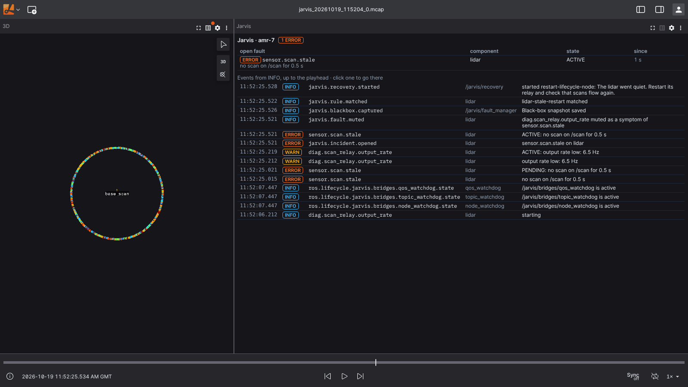

# Jarvis in Foxglove and Lichtblick

Whoever debugs a robot in [Foxglove](https://foxglove.dev) or
[Lichtblick](https://github.com/lichtblick-suite/lichtblick) (its open-source fork) has the robot's
data there: the lidar, the camera, the costmaps, the plots. The Jarvis panel puts what Jarvis knows
next to it: the faults open right now, worst first, over Jarvis's events. Live through
foxglove_bridge, or from Jarvis's recordings, where the log runs up to the playhead and a click on
an event takes the playback there.



1. [Install the panel](#1-install-the-panel)
2. [Live, from the robot](#2-live-from-the-robot)
3. [On a recording](#3-on-a-recording)
4. [Settings](#4-settings)
5. [Build it](#5-build-it)

## 1. Install the panel

Each release has the panel attached: `guilyx.jarvis-panel-<version>.foxe` (every CI run of a commit
has it too, the `jarvis-panel` artifact). Drag the file onto the Foxglove or Lichtblick window, or
install it from _Settings → Extensions_. Then add the **Jarvis** panel to a layout, next to the 3D
view of your robot.

It reads two topics, both in `jarvis_interfaces`:

| Topic | What the panel shows |
|-------|----------------------|
| `/jarvis/faults` (`FaultArray`, latched) | The open faults: pending, active and latched ones; muted symptoms left out. Worst first, then latched first, then the oldest; their component, state and how long they have been open. The header counts the critical, error and warning ones |
| `/jarvis/event_batches` (`EventBatch`) | The events: faults raised, confirmed and cleared, rule matches, recovery steps, incidents, insights, operator actions. Newest first, each once |

## 2. Live, from the robot

Run [foxglove_bridge](https://docs.foxglove.dev/docs/connecting-to-data/ros-foxglove-bridge) next to
Jarvis and open `ws://<robot>:8765` (_Open connection → Foxglove WebSocket_):

```bash
ros2 launch foxglove_bridge foxglove_bridge_launch.xml     # on the robot
ros2 launch jarvis_demo demo.launch.py foxglove:=true      # the demo starts it for you
```

The Docker demo runs it already: `ws://localhost:8765`. The panel shows the faults as they open and
clear, and the events from the moment it connects (the last 500 by default).

foxglove_bridge has no authentication and serves every topic, service and parameter of the robot:
keep it on the robot's network, or reach it through an SSH tunnel
(`ssh -L 8765:localhost:8765 robot`), as you would a ROS graph. The gateway's API, with its users
and roles, is what to put on a wider network ([security guide](security.md)).

## 3. On a recording

Jarvis records `/jarvis/**` to MCAP, continuously, in `<data_dir>/bags/jarvis_<stamp>/` (splits of
5 minutes, `split_duration_s`). Open the files (several at once is fine) and the panel reads the
whole event stream of the recording:

- **The log runs up to the playhead**: everything that had happened by then, newest first. Scrub
  the timeline and it follows.
- **A click on an event takes the playback there**: the faults that were open at that moment, the
  rest of the layout (the lidar, the plots) as it was.

For the robot's own data in the same file, have Jarvis record it too: `record_extra_topics`
(default `/diagnostics /rosout`), e.g. `record_extra_topics:="/diagnostics /rosout /scan /tf /tf_static"`.
The black box's snapshots (`<data_dir>/blackbox/`) carry the events with the robot's topics around
a fault, but not `/jarvis/faults`: the panel shows their events.

## 4. Settings

In the panel's settings (the gear of the panel, or the sidebar when it is selected):

| Setting | Default | For |
|---------|---------|-----|
| Faults topic | `/jarvis/faults` | A Jarvis under a namespace, or remapped |
| Events topic | `/jarvis/event_batches` | Same |
| Events from | `INFO` | The lowest severity shown (`DEBUG` for everything, `WARN` for what went wrong) |
| Events kept | `500` | How many events are shown |

They are saved with the layout.

## 5. Build it

The panel is a Foxglove extension (`@foxglove/extension`), in
[`foxglove/jarvis-panel`](../../foxglove/jarvis-panel):

```bash
cd foxglove/jarvis-panel
npm ci
npm run lint && npm run typecheck && npm test
npm run package          # guilyx.jarvis-panel-<version>.foxe
npm run local-install    # straight into the Foxglove desktop app on this machine
```

Tested with Lichtblick 1.29 (built from source) and foxglove_bridge 3.6 on ROS 2 Jazzy, live and on
the recordings of the demo. It reads a recording's events with `subscribeMessageRange` (Foxglove)
or `unstable_subscribeMessageRange` (Lichtblick), whichever the app has.
